# S&P 500 Radar architecture

**S&P 500 Radar** monitors the index for price movements and Isolation Forest anomalies, with same-day headline checks that grade how well the news explains the session. One alert per symbol per day: a price move, a news-sentiment alert, or a news + price alert when both rules fire.

Two product paths sit side by side:

- **Live** — continuous Kafka minute bars → Home **Live alerts** (monitor the session while it is open).
- **Watchlist** — a focus set of index constituents plus on-demand **Scan today** → **Watchlist results** (session / day review under current rules, including after the close).

Both write the same Postgres `alerts` table. History shows **Origin**, **Company**, **Type**, **Price change**, and **Sentiment score** (sortable columns); click a row for the full write-up. The **batch lake** (`batch_ingest` + `batch_train`) trains Isolation Forest on historical prices; it is not the Watchlist UI. Watchlist Scan today is the useful product pass over the **focus session** (today during/after RTH; the last completed session before the open or on weekends) plus near-term headlines.

The class design (CISC 525) is a **local lambda architecture** in the classic sense — a **batch layer** (historical lake + train) plus a **speed/stream layer** (Kafka + live scorer) that serve the same alerts table. That is *not* AWS Lambda. On this machine: Docker Kafka on the live path, a batch lake on disk, a Spark-**role** training job, FinBERT for near-term headline sentiment, an Isolation Forest trained on lake price/volume features, and Perplexity for the alert wording. How the original proposal slides map onto this stack — including what we kept, changed, or dropped and why — is [proposal-pipeline-audit.md](proposal-pipeline-audit.md).

**Deploy target:** one developer machine (Docker Desktop + Postgres + local lake). Cloud names from the original deck (S3, Aurora, managed Flink) map to local stand-ins below. This project does **not** require an AWS production deploy for the class demo.

**How to read the diagrams below.** They are one finished system at increasing grain — not two generations of the design. Keep all of them for the presentation. Flowcharts are laid out **left → right** in numbered stage columns (slide-friendly landscape); sequence diagrams stay top → bottom in time order. Each box names the **job in plain language**, then the **technical role** in parentheses (data lake, Kafka topic, Flink-role processor, Postgres table, and so on).

1. **System overview** — lake train, Live, Watchlist, serving  
2. **System overview with ML + AI** — same map with FinBERT grade + optional Perplexity wording called out  
3. **Watchlist Scan today** / **Live price stream** / **Batch lake** / **Curated features + Isolation Forest** — path-level detail  
4. **High-level lambda architecture** — batch + speed layers (the *pattern*, not AWS Lambda) with local stand-ins  
5. **Batch historical ELT** — land → curate → train → registry  
6. **Streaming ETL** — Kafka → live scorer → headline grade → alerts  
7. **End-to-end alert sequence** — bar → gate → headlines → Perplexity → UI

This repository runs:

- Alpaca delayed SIP minute bars onto local Kafka (`stream_ingest/`)
- A FastAPI consumer (`python -m app.live`) that writes open→last **price** alerts from the stream (percent rule **or** registered Isolation Forest when the lake registry is present), then runs a same-day headline check and grades how well the news explains the move
- Live feature vectors + forest scores into Postgres `live_feature_rows` (Timescale stand-in)
- **Watchlist** tab: focus-set search, **Scan today** over Yahoo daily bars + FinBERT headlines — same **percent or forest** price gate as live, then the same-day headline grade; Watchlist results separate from Home Live alerts
- Perplexity richer reasoning for news / news+price when a key is saved (price-only stays deterministic); forest-aware deterministic wording when Isolation Forest fires; granular evidence story on Home, Watchlist, and Details (What happened leads with a tone-colored alignment outcome chip)
- Batch land of about one year of S&P daily prices into `data/lake/raw/` (automatic on first boot when the lake is empty; Settings **Land** / `batch_ingest/` as overrides) for **model training**
- Incremental **Refresh lake + retrain** (automatic on a daily schedule; Settings / CLI as overrides) — per-symbol resume from the latest lake date (lookback capped ~14 calendar days); skips Yahoo + retrain when already current through the last completed session; header progress % while running
- Curated session features + Isolation Forest registry (`batch_train/`) — used by **both** Live and Watchlist Scan today
- Alert History with Origin, Company, Type, Price change, and Sentiment score; Mac/Chrome desktop notifications and a tab badge when new alerts arrive

This is the finished local system for the class demo. Near-term headlines are fetched and FinBERT-scored **after** a price or forest gate (or on Watchlist Scan today) — there is no separate Kafka news topic. **Historical headlines are not landed and are not training features.** There is no shared package with Vajra Astra Capital.

## What ships

| Capability |
|---|
| Watchlist tab: S&P 500 focus set (search + chips), Scan today, Watchlist results separate from Home Live alerts |
| Home tab: **Live alerts** feed with All / Watchlist / Others scope switch; Clear alerts; desktop notification controls |
| History tab: full list with Origin, Company, Type, Price change, Sentiment score; click row for details; sortable + draggable columns |
| Yahoo daily bars into `daily_bars` for Watchlist Scan today / rebuild (session-day product pass) |
| Near-term Yahoo headlines scored with local FinBERT (0–100), with confidence and class shares |
| Price alert: open→last while the market is open; close versus prior close after the close. Volume spike note on the completed close |
| News alert and news + price when the headline’s price slice clears the same percent |
| Plain-English summary; Perplexity richer news / news+price reasoning when a key is saved (price-only stays deterministic); Summary citations render as clickable headline titles (bare URLs linked from the alert’s article list) |
| Expanded alert metric tiles: Price change shows `$from → $to` plus a short span caption (`open → last`, `prior close → close`, …); Sentiment score shows FinBERT class counts (lead bucket, then the other two) |
| Saved thresholds; admin rebuild of recent sessions for the watchlist |
| Minute bars on Kafka from Alpaca `delayed_sip` (WebSocket ≤30 on Basic; REST fills the rest of the S&P 500) |
| Live Kafka consumer over the **full S&P 500** stream (not limited to Watchlist chips): open→last price alerts (`python -m app.live`); Home “Live alerts on” heartbeat |
| Historical Yahoo daily bars for the S&P 500 (~1 year) in the lake raw zone (**training lake**, not the Watchlist UI) |
| Auto first-boot lake land + train when `data/lake` is empty; header “Loading historical prices” cue + % progress |
| Incremental lake refresh: resume from each symbol’s latest lake date (cap ~14d); skip Yahoo + retrain when already current through the last completed session (pre-open aware); daily auto schedule; Settings / CLI overrides |
| Watchlist Scan today focus session: last completed session before the cash open / on weekends; today during RTH or after the close |
| Spark-role curated feature table (gap, session, close, volume z-score) and Isolation Forest registry via `batch_train` (local pandas/scikit-learn) |
| Live scorer loads the registry and scores session features from Kafka bars (Flink role); Postgres `live_feature_rows` sink |
| Watchlist Scan today / rebuild uses the same Isolation Forest registry (percent **or** forest) before the same-day headline grade |
| Mac/Chrome desktop notification (Notification Center) plus tab title/favicon badge when new alerts arrive from Scan today or live |
| Live price → same-day headline grade: after a percent or forest price alert, fetch/score headlines and grade how well the news explains the move (news / news+price when the slice supports it; price-only when it does not); Perplexity on news kinds |
| Evidence story with granular second-side alignment (supports / somewhat supports / neutral / disagrees / contradicts) on Home, Watchlist, and Details; What happened outcome chip emphasizes the grade |
| Richer forest-aware price-only wording (deterministic Summary / Price / Forest / What happened when Isolation Forest fires; percent status + feature drivers; still no Perplexity on bare price-only) |

Out of scope: Cassandra, FinBERT fine-tuning, VWAP as a stream stage, a generic LLM box, a historical news lake, sentiment features inside Isolation Forest training, a Kafka news topic, and a mandatory AWS production deploy.

A normal check writes the current Eastern trading day. The admin rebuild deletes saved alerts and reapplies rules over the last 1–40 calendar days for the watchlist. It is not the training lake. Model training reads lake Parquet, not the rebuild.

## Proposal audit

[proposal-pipeline-audit.md](proposal-pipeline-audit.md) is the revised class plan that led here. Diagrams below describe the **finished** local system. Cassandra, FinBERT fine-tune, VWAP, and a generic LLM box are out of scope. Historical news is not part of the batch lake. S3/Aurora on older slides mean `data/lake` and local Postgres.

### What this repository does

| Capability | How it runs here |
|---|---|
| Minute bars on Kafka, scored by the registered forest | Minute bars on Kafka from Alpaca. `python -m app.live` applies the open→last **percent** rule and scores session features with the registered Isolation Forest; rows land in `live_feature_rows` |
| FinBERT on near-term headlines | FinBERT on Watchlist Scan today and after a live price / forest alert. Weights on this machine. No historical news land |
| Slice join, news-only and price-only | Same Eastern day; gap, session, or close slice. Live and Scan today: price first, then a headline check that grades how well the news explains the session; news-only still allowed on Scan today |
| Watchlist focus set beside the live feed | Watchlist tab for Scan today / Watchlist results; Home **Live alerts** for the Kafka stream; History Origin distinguishes the writer |
| Perplexity after the decision | When a key is saved for news / news+price; model name under Together; price-only keeps the rule sentence; article URLs in the reply become clickable headline titles |
| Lake, Spark-role training, registry | Raw under `data/lake/raw/` via auto first-boot **Land**, scheduled **Refresh**, or Settings/CLI. Refresh resumes from latest local dates and no-ops when current. `batch_train` writes curated features and `data/lake/registry/isolation_forest/current/`. Live and Scan today both score with that registry |
| One alert per symbol per day | One row per symbol per day (`alerts.origin` tracks live / watchlist / both) |
| Notify the trader after the row exists | OS desktop notification + tab badge (`ui/sw-notifications.js`). Slack and email are not used |

### Local stand-ins (no AWS required)

| Original deck / cloud name | Local stand-in in this repo |
|---|---|
| S3 data lake | `data/lake/` Parquet on disk |
| Aurora / RDS | Local Postgres `ticker_alert_db` |
| Managed Kafka | Docker Compose Kafka |
| Spark cluster (EMR / Dataproc) | `batch_train` Spark-**role** job (pandas ELT + scikit-learn Isolation Forest) |
| Flink on Kinesis/MSK | Local Flink-**role** live scorer in `python -m app.live`: same four features + registry cutoff |
| Timescale (managed) | Postgres `live_feature_rows` (Timescale stand-in) |
| Slack / email | Mac/Chrome desktop notification + tab badge |

## System overview

Everything that runs on one machine. Three paths stay distinct: the **training lake**, **Live** (continuous), and **Watchlist Scan today** (on-demand session pass). Live and Scan today both use the **percent rule or** the registered Isolation Forest (same lake registry) as the price gate, then a same-day headline check that grades how well the news explains the session.

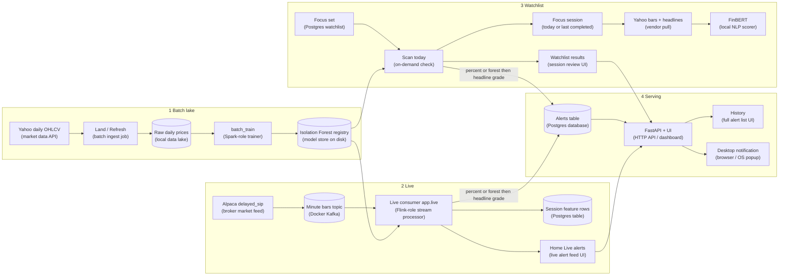

## System overview with ML + AI

Same machine and the same four lanes, with one more grain of detail for the class requirements. **Streaming** and **batch** still feed the system; **Isolation Forest** is the machine-learning path (trained on the lake, applied on Live and Watchlist); **FinBERT** scores near-term headlines after a price/forest hit; **Perplexity** is the LLM AI step — optional richer wording for news / news+price after the alert decision, before the dashboard. Price-only rows stay on the deterministic rule text.

```mermaid
flowchart LR
    subgraph batch [1 Batch lake + ML train]
        direction TB
        YF["Yahoo daily OHLCV<br/>(market data API)"] --> LAND["Land / Refresh<br/>(batch ingest job)"]
        LAND --> RAW[("Raw daily prices<br/>(local data lake)")]
        RAW --> BT["batch_train<br/>(Spark-role trainer)"]
        BT --> REG[("Isolation Forest registry<br/>(ML model store)")]
    end

    subgraph stream [2 Live stream]
        direction TB
        ALP["Alpaca delayed_sip<br/>(broker market feed)"] --> KAFKA[("Minute bars topic<br/>(Docker Kafka)")]
        KAFKA --> LIVE["Live consumer app.live<br/>(Flink-role stream processor)"]
        LIVE --> GATE1["Percent or forest gate<br/>(price / anomaly check)"]
        GATE1 --> FB1["FinBERT headline grade<br/>(local NLP scorer)"]
        LIVE --> FEAT[("Session feature rows<br/>(Postgres table)")]
        LIVE --> HOME["Home Live alerts<br/>(live alert feed UI)"]
    end

    subgraph watch [3 Watchlist on-demand]
        direction TB
        WL["Focus set<br/>(Postgres watchlist)"] --> RUN["Scan today<br/>(on-demand check)"]
        RUN --> FOCUS["Focus session<br/>(today or last completed)"]
        FOCUS --> YB["Yahoo bars + headlines<br/>(vendor pull)"]
        YB --> GATE2["Percent or forest gate<br/>(price / anomaly check)"]
        GATE2 --> FB2["FinBERT headline grade<br/>(local NLP scorer)"]
        RUN --> CHECK["Watchlist results<br/>(session review UI)"]
    end

    subgraph serve [4 Alerts, AI wording, serving]
        direction TB
        PG[("Alerts table<br/>(Postgres database)")] --> PPLX["Perplexity<br/>(LLM wording API)"]
        PPLX --> API["FastAPI + UI<br/>(HTTP API / dashboard)"]
        PG --> API
        API --> HIST["History<br/>(full alert list UI)"]
        API --> NOTE["Desktop notification<br/>(browser / OS popup)"]
    end

    REG --> LIVE
    REG --> RUN
    FB1 -->|decision row| PG
    FB2 -->|decision row| PG
    HOME --> API
    CHECK --> API
```

## Live and Watchlist side by side

| | Live | Watchlist Scan today |
|---|---|---|
| Job | Continuous monitoring while RTH is open | Deliberate review of the focus set under **current** rules |
| UI | Home → **Live alerts** (scope: All, Watchlist, or Others) | Watchlist → chips + **Scan today** → **Watchlist results** |
| Inputs | Kafka minute bars (+ near-term Yahoo headlines after a price/forest hit) | Yahoo `daily_bars` + near-term headlines for watchlist symbols |
| Focus session | Wall-clock RTH / live open→last | **Today** during RTH or after the close; **last completed weekday** before the open / on weekends |
| Price gate | open→last **percent or** Isolation Forest (lake registry) | Same **percent or** Isolation Forest on the focus session’s vector |
| When it shines | Deployed day; laptop left open on the stream | Pre-market catch-up; after the close; after changing Settings; class demo without Kafka |
| Origin on the row | `live` (or `both` if Scan today also wrote the day) | `watchlist` (or `both` if live also wrote the day) |

The lake batch path does **not** replace Watchlist. Lake Parquet trains the forest. Watchlist Scan today is the product pass over **this session’s** bars and headlines for names you care about.

## Price gates (percent **or** forest)

Either gate can open a **price-led** day. They are not both required. What happened tags the case in brackets on the price step (`(percent only)`, `(percent + forest)`, `(forest only)`, `(neither gate)`).

| Percent | Forest | Price-led alert? | What happened tag |
|---|---|---|---|
| Clears (e.g. ≥ 3%) | Normal / absent | **Yes** — percent alone | `(percent only)` |
| Clears | Anomalous | **Yes** — both | `(percent + forest)` |
| Under threshold | Anomalous | **Yes** — forest alone | `(forest only)` |
| Under threshold | Normal / absent | **No** price-led | `(neither gate)` — typical news-led Scan today case |

## What can trigger a price-led alert

| # | Trigger | Opens a price alert alone? | Notes |
|---|---|---|---|
| 1 | **Price move threshold** — open→last (RTH) or close vs prior (after close / Scan) ≥ Settings % (UI label: Price move threshold) | **Yes** | Live + Watchlist |
| 2 | **Isolation Forest anomalous** — score ≤ registry cutoff on the four-feature vector | **Yes** (even if under %) | Live + Watchlist |
| 3 | **Gap return** (open vs prior close) | No — forest **feature** | Inside #2 |
| 4 | **Session return** (open→last) | No — forest **feature** (and #1 if large enough) | Inside #1 / #2 |
| 5 | **Close return** (last vs prior close) | No — forest **feature** | Inside #2 |
| 6 | **Volume z-score** (today’s volume vs ~20 prior days) | No — forest **feature** | How “heavy trading” usually fires |
| 7 | **Volume spike note** (≥ ~2× recent average on a completed daily close) | **No** — annotation only | Shown when a percent-led daily card also spiked |

The price step also adds a compact trigger note, e.g. `[triggers: #1 percent]`, `[triggers: #2 forest (#6 volume z, #3 gap)]`, or `[triggers: #1 percent + #2 forest; #7 volume spike noted]`. News-led cards under both gates show `[triggers: none (price under both gates)]`.

## Watchlist Scan today

**Scan today** or rebuild on the Watchlist tab. Live Kafka price path is the next diagram.

**Focus session:** during the cash session (9:30–16:00 Eastern) or after the close on a weekday, Scan today evaluates **today**. Before the open — and on weekends — it evaluates the **last completed weekday** (as of that session’s 4:00 PM close) so a pre-market run is not empty. Alert `when` stamps stay on that session’s clock.

```mermaid
flowchart LR
    subgraph ingest [1 Ingest]
        direction TB
        WL["S&P 500 watchlist<br/>(focus-set table)"] --> RUN["Scan today or rebuild<br/>(on-demand job)"]
        RUN --> FOCUS["Focus session<br/>(today or last completed)"]
        FOCUS --> PX["Yahoo daily bars<br/>(market data API)"]
        FOCUS --> NW["Near-term headlines<br/>(news API pull)"]
        PX --> BARS[("daily_bars<br/>(Postgres table)")]
        NW --> SCORE["FinBERT 0 to 100<br/>(local NLP scorer)"]
        SCORE --> NEWS[("headlines<br/>(Postgres table)")]
    end

    subgraph gates [2 Price and news gates]
        direction TB
        BARS --> PCT["Percent rule<br/>(price threshold gate)"]
        BARS --> IF["Isolation Forest<br/>(anomaly model gate)"]
        PCT --> PA["Price alert<br/>(draft row)"]
        IF --> PA
        NEWS --> NA["FinBERT threshold<br/>(sentiment gate)"]
        NA --> NEWSALERT["News alert<br/>(draft row)"]
    end

    subgraph join [3 Slice join]
        direction TB
        PA --> ONE{Headline explains slice?}
        NEWSALERT --> ONE
        ONE -->|both| FA["News plus price<br/>(aligned alert)"]
        ONE -->|price only| PA2["Price-led<br/>(news did not explain)"]
        ONE -->|news only| NA2["News-led<br/>(price under gates)"]
    end

    subgraph out [4 Output]
        direction TB
        FA --> RULE["Summary<br/>(deterministic wording)"]
        PA2 --> RULE
        NA2 --> RULE
        RULE --> KEY{Perplexity key?}
        KEY -->|yes news kinds| PPLX["Perplexity<br/>(LLM wording API)"]
        KEY -->|no or fail| ALERTS[("alerts<br/>(Postgres table)")]
        PPLX --> ALERTS
        ALERTS --> UI["Watchlist / History / Details<br/>(dashboard UI)"]
        UI --> NOTE["Desktop notification<br/>(browser / OS popup)"]
    end
```

Home asks for notification permission (Enable desktop notifications). When Scan today or a live refresh adds alert rows, the open tab raises a Mac/Chrome Notification Center popup and sets `(N)` on the title with a favicon badge. Opening Home clears the unread count. Scan today results stay on the Watchlist tab so Home Live alerts are not overwritten. Perplexity runs in batches of eight for news kinds; the model name under Together appears when a rewrite succeeds. Slack and email are not used.

## Live price stream

Docker Kafka, Alpaca producer, and `python -m app.live`. The consumer accepts Kafka bars for the **full S&P 500 universe** (Watchlist chips are only the Scan today focus set — not a live filter). Writes **price** alerts with the **percent rule** and, when the lake registry is present, scores the same four session features with the registered Isolation Forest (Flink role). After a live price (or forest) alert, the consumer fetches near-term Yahoo headlines, scores them with FinBERT, and grades how well the news explains the session — upgrading to news or news+price when the same-day slice supports it, otherwise keeping price-only with that grade. Same join as Watchlist Scan today. The upgrade path keeps `origin=live` (it does not fall back to the evaluate default of `watchlist`). News / news+price rows go through Perplexity when a key is saved. Feature vectors land in Postgres `live_feature_rows`. The Home Live alerts feed polls alerts; `/v1/live/status` drives the Live alerts on pill. Rows are tagged `origin=live` (or merge to `both` when Scan today also wrote that symbol-day).

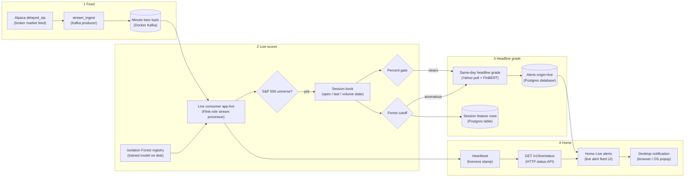

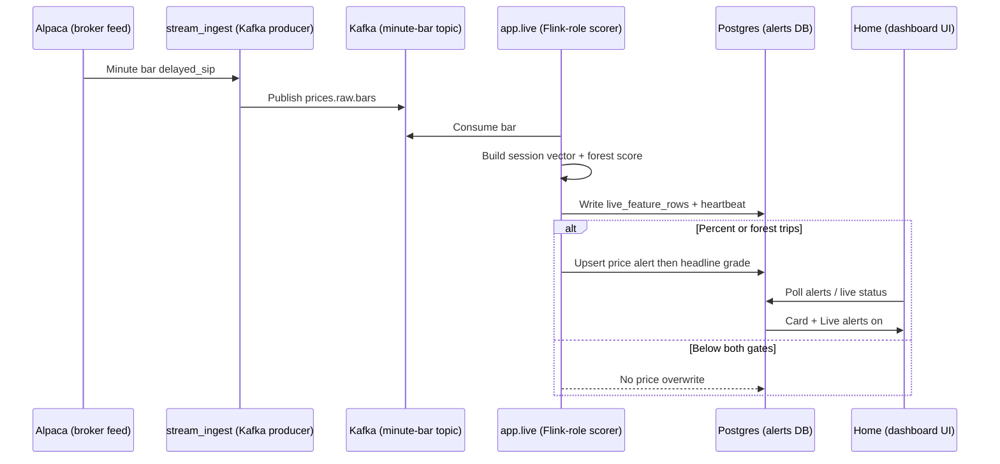

## Batch lake land and refresh

S&P 500 daily prices only. No historical headlines. Local disk lake (S3 stand-in). On first API boot with an empty lake, **auto land + train** runs (~1 year) and the UI header shows “Loading historical prices” with a **% progress** bar. A **daily auto refresh** (and Settings Refresh merge) checks each symbol’s latest lake date first: if everything is already through the **last completed session** (pre-open aware — before 4:00 PM Eastern “today” is not required yet), it **skips Yahoo and retrain** and reports that session target in the status line (finished time shown in US Eastern). Otherwise it resumes from that latest date (lookback capped ~14 calendar days), merges by `dt` (union by dt keep newest), then runs `batch_train`. Settings **Land** remains a full replace. Kafka minute bars do **not** write the lake — a mid-session Refresh that finds the lake already through yesterday is expected.

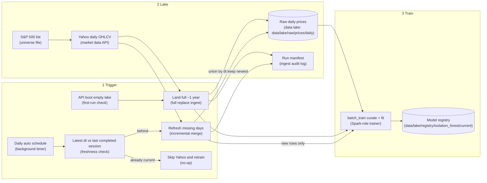

## Curated features and Isolation Forest

Local Spark-**role** job [`batch_train`](../batch_train/): pandas ELT + scikit-learn Isolation Forest. Four price/volume features only. Registry under `data/lake/registry/isolation_forest/current/`. Not a Dataproc/EMR cluster; same *job* the diagrams call Spark training. Live and Watchlist Scan today both load this registry for the **percent or forest** price gate.

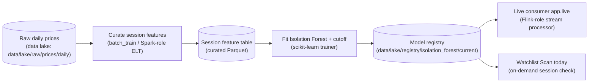

## High-level lambda architecture

This is the classic **lambda architecture pattern** (batch layer + speed/stream layer → serving), **not** AWS Lambda. Batch trains on **price history**, with automatic first-boot land and incremental **Refresh lake + retrain** so the registry stays current. Stream scores minute bars with that model and runs a same-day headline check that grades how well the news explains the session. Watchlist Scan today uses the **same percent or forest** gate and headline grade on daily bars. Headlines join by pull-after-price (or on Scan today), not via a Kafka news topic. Everything stays on the local machine. No historical news lake. No AWS requirement.

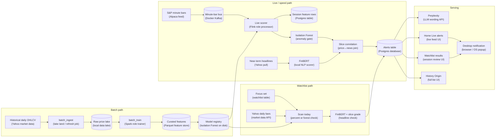

## Batch historical ELT

Land raw **prices**, build price/volume features, fit the forest. FinBERT is not fine-tuned and is not a batch input. This path runs via `batch_ingest` + `batch_train`.

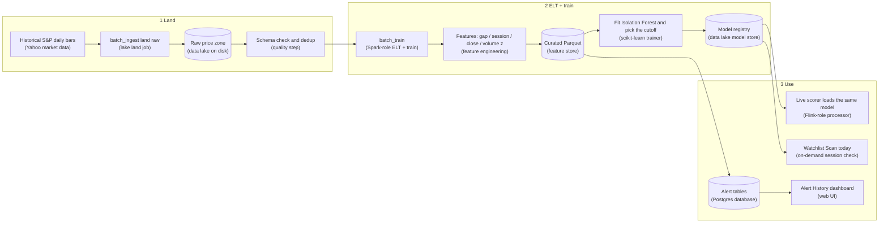

## Streaming ETL

Minute bars are scored by the registered forest. **Product join is price-first on Live and Watchlist Scan today:** when the percent rule or forest marks a move, the scorer fetches near-term headlines for that symbol, scores them with FinBERT, and grades how well the news explains the session — news or news+price when the same Eastern-day slice supports it, otherwise price-only with that grade. Stale prior-day stories stay out. Postgres holds the alert with `origin`. Perplexity writes after news / news+price rows exist. The details popup shows the evidence story with a granular second-side alignment (supports / somewhat supports / neutral / disagrees / contradicts). What happened leads with a muted check path plus a tone-colored outcome chip for that grade (mismatches also emphasize the final step).

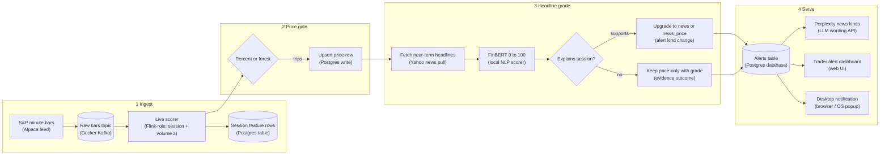

## End-to-end alert sequence

Price-only and news-only are allowed. The happy path below is **price noticed → headlines checked → grade how well the news explains the session**. Perplexity never decides the alert. The forest features are price and volume only. Watchlist Scan today uses the same join on daily bars for the focus set.

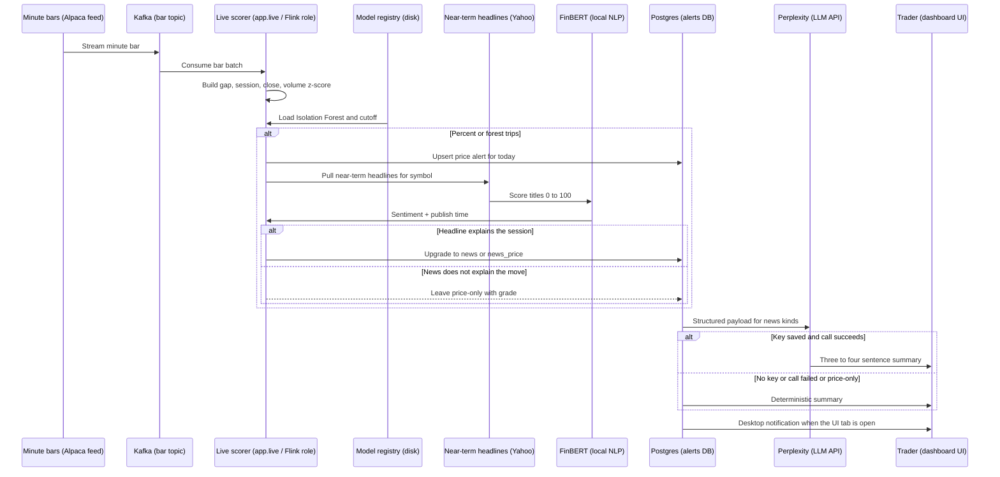

## Local schema

`watchlist` holds the S&P 500 focus set for Scan today and rebuild. `symbols` caches the Yahoo sector or fund category. `daily_bars` and `headlines` are Watchlist Scan today inputs (near-term headlines only). `app_settings` stores the price fraction, the FinBERT sentiment threshold, the optional Perplexity API key, the selected Perplexity model, and `live_consumer_heartbeat_at` for the Home live cue. The default threshold is 25 points from 50. The default model is `openai/gpt-5.4-mini`. `alerts.kind` is `price`, `news`, or `news_price`. `alerts.origin` is `live`, `watchlist`, or `both`. `live_feature_rows` stores live session feature vectors and Isolation Forest scores from `python -m app.live`.

One row per symbol per `bar_date`. A repeated check replaces that day's alert and keeps `created_at`. When live and watchlist both write the same day, `origin` becomes `both`. The row also stores `price_move_threshold` and `sentiment_threshold` from the moment it fired. Price drafts stamp `sections.price_span` with a short from→to caption for the expanded Price change tile. When Perplexity rewrites Together, the alert `sections` keep the rule sentence, the model id, and the model label shown under Together; bare article URLs in the reply are rewritten to `[title](url)` on save and rendered as clickable headline links in the Summary (including older rows that still store a raw URL). Evidence steps live under `sections.evidence` with an `alignment` grade. A headline is eligible only when it was published on that Eastern trading day and is inside the news lookback.

`sentiment_scorer` stays `finbert`. FinBERT loads ProsusAI/finbert on this machine. The stored score is 0 to 100, with 50 neutral. Confidence is the winning class probability. A headline is eligible when the score is at least the saved number of points from 50.

The lake under `data/lake/` holds raw daily OHLCV, curated session features, and the Isolation Forest registry. It is separate from Postgres alerts.
