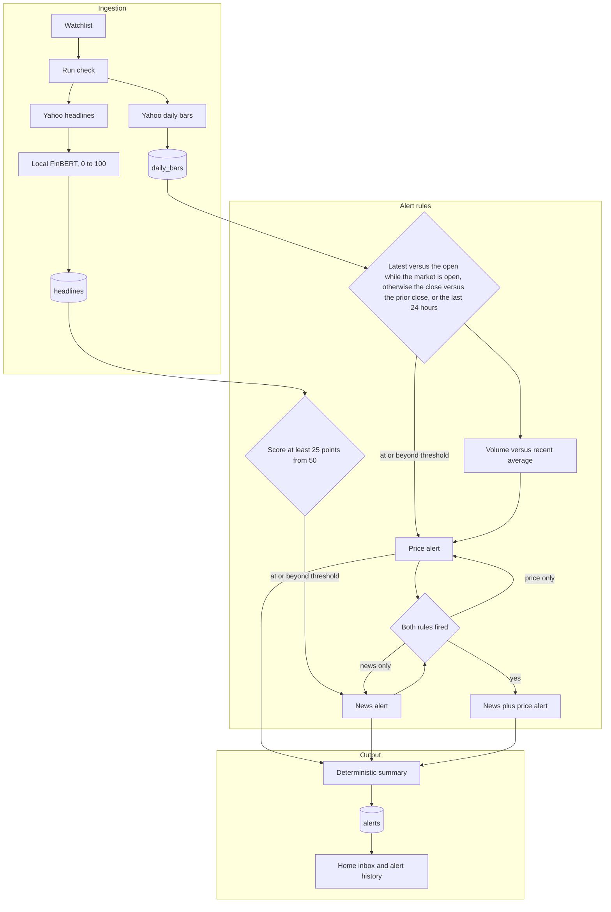
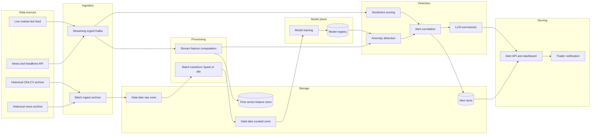
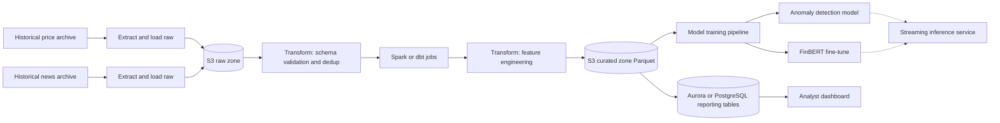
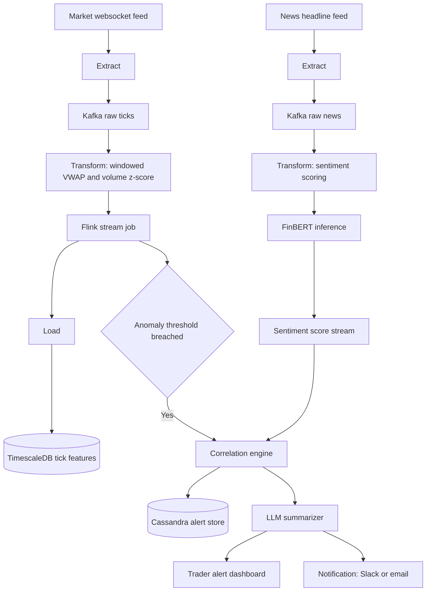
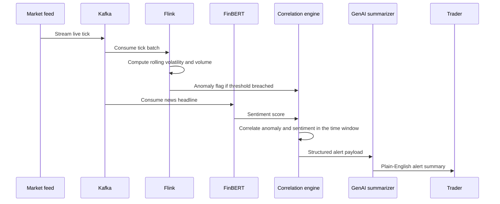

# Ticker Alert System architecture

Local decision-support service that turns a watchlist into one alert per symbol per day: a price move, a news-sentiment alert, or a news + price alert when both rules fire.

The class design (CISC 525) is a lambda architecture: Kafka and Flink on the live path, Spark and a data lake on the historical path, FinBERT for sentiment, an Isolation Forest trained on that lake, and Perplexity for the alert wording. The revised plan is [proposal-pipeline-audit.md](proposal-pipeline-audit.md). This repository runs a smaller path: FastAPI, PostgreSQL, Yahoo daily bars, local FinBERT, and a deterministic summary.

There is no shared package with Vajra Astra Capital. Common logic lives in this repo as its own copy.

## Status

| Capability | Status |
|---|---|
| Watchlist of tickers, with a local symbol and company-name search. A suggestion fills the box. Add rejects a symbol that is not on that list and that Yahoo does not quote | **As-built** |
| Yahoo daily bars into `daily_bars` | **As-built** |
| Yahoo headlines scored with local FinBERT on a 0–100 scale, with confidence and a class breakdown | **As-built** |
| Price alert: while the market is open, the latest price versus the open; after the close, the close versus the prior close; the last 24 hours for a market that trades all day. A volume-spike flag is on the completed stock close | **As-built** |
| News alert: absolute sentiment at or beyond the configured threshold, on that headline's trading day | **As-built** |
| News plus price only when the headline's price slice clears the same percent rule. Otherwise news with no price, or price with no headline lined up | **As-built** |
| Plain-English summary from the alert fields, including the thresholds in force when it fired | **As-built** |
| Home inbox of alerts since the app was last opened, plus a sortable alert history | **As-built** |
| Saved price and sentiment thresholds | **As-built** |
| Admin rebuild: wipe alerts and rerun the current rules over the last 1–40 calendar days | **As-built** |
| Symbol links to the Yahoo Finance quote, from Home, History, and the details title | **As-built** |
| Minute bars for the watchlist on Kafka (Alpaca / Databento) | **Target** |
| Flink session features scored with the registered Isolation Forest | **Target** |
| FinBERT inference on each headline, locally, during a check | **As-built**. Not a live score stream |
| Spark feature table on S3, Isolation Forest fit on that table, model registry | **Target** |
| Correlation on the price slice (gap, session, or close), including news-only and price-only | **Target** |
| Perplexity two-sentence summary, with the deterministic sentence as fallback | **Target** |
| Slack or email notification | **Target** |

A normal check writes only the current Eastern trading day. The admin rebuild is the historical pass we can run now: it deletes saved alerts and reapplies the current rules to each session in the chosen window. It is not the proposal's training lake. Yahoo's quote-news list is newest first and can run out before the first day of a long window, especially for a busy ticker. A rebuild pages that list back through the window and scores each story for the trading day it was published. Sessions with no remaining headline stay price-only.

## Proposal audit

The class deck (CISC 525, 30 Aug 2026) asks for batch processing and stream processing in a big-data architecture, plus machine learning and an AI summary. [proposal-pipeline-audit.md](proposal-pipeline-audit.md) is the revised plan. The mermaid diagrams below are the deck as drawn. The audit says which boxes stay, which change, and which come off.

The revised target keeps both engines and one feature list. Spark lands historical bars and stored headlines in S3, builds one feature row per symbol per session, and fits an Isolation Forest. The registry holds that model, the feature list, and the score cutoff. Flink scores the same vector on live minute bars from Kafka and writes feature rows to TimescaleDB. FinBERT scores headlines on the stream. Correlation joins a headline to the slice in progress and still allows news-only and price-only. Perplexity writes two sentences from the finished payload. The deterministic sentence remains the fallback. Postgres is the alert of record. Cassandra is not part of the target.

### What this repository does instead

| Revised target | This app |
|---|---|
| Minute bars on Kafka, scored by the registered forest | While the market is open, the latest price versus the open. After the close, the close versus the prior close. A market that trades all day, such as BTC-USD, uses the price change over the 24 hours before the check. A volume spike is a note on a completed stock close, not a separate detector |
| FinBERT score stream | FinBERT on each headline during a check. The weights run on this machine. There is no score stream and no second scorer |
| Slice join, with news-only and price-only | Same Eastern trading day, then one slice: the overnight gap before 9:30 AM, the regular session until 4:00 PM, or the close after that. A 24-hour market uses the four hours after the headline. Fusion says "candidate reason" only when that slice clears the price rule. Otherwise the card is news with no price, or price with no headline lined up. Weekend stories stay with Friday |
| Perplexity, two sentences, after the decision | Deterministic sentences, plus the thresholds saved on the alert |
| S3 lake, Spark training, model registry | Admin rebuild of the last 1–40 calendar days from Yahoo bars and stored headlines. Current settings are applied again, and previous alerts are deleted |
| One alert per symbol per day | One row per symbol per day |

The rebuild is the closest thing we have to the historical path. It replays rules. It does not train a model or tune a threshold.

## As-built check

## Deck: high-level lambda architecture

Streaming path for live detection. Batch path for training and historical reporting. These diagrams are the 30 Aug 2026 deck. The revised boxes, including Perplexity and the forest trained on the curated table, are in [proposal-pipeline-audit.md](proposal-pipeline-audit.md). None of this is what the local process runs today.

## Deck: batch historical ELT

Extract and load raw history, then transform in the lake.

## Deck: streaming ETL

Extract live ticks and headlines, transform in flight, then load curated results.

## Deck: end-to-end alert sequence

## Local schema

`watchlist` holds the symbols a check will refresh. `symbols` caches the history label: a Yahoo sector for a stock, the fund category for an ETF or mutual fund, and Crypto for a coin or a digital-asset fund. `daily_bars` and `headlines` are the inputs. `app_settings` stores the price fraction and the FinBERT sentiment threshold. The default threshold is 25 points from 50. `alerts.kind` is `price`, `news`, or `news_price`.

One row per symbol per `bar_date`. A repeated check replaces that day's alert and keeps `created_at`. The row also stores `price_move_threshold` and `sentiment_threshold` from the moment it fired. A headline is eligible only when it was published on that Eastern trading day and is inside the news lookback.

`sentiment_scorer` stays `finbert`. FinBERT loads ProsusAI/finbert on this machine. The stored score is 0 to 100, with 50 neutral. Confidence is the winning class probability. A headline is eligible when the score is at least the saved number of points from 50.
