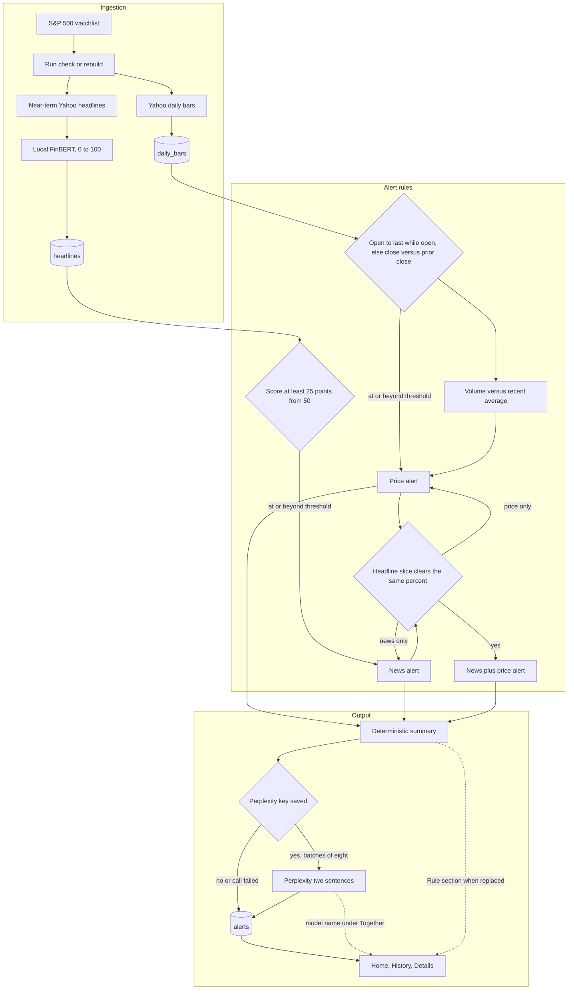
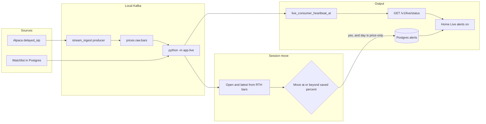
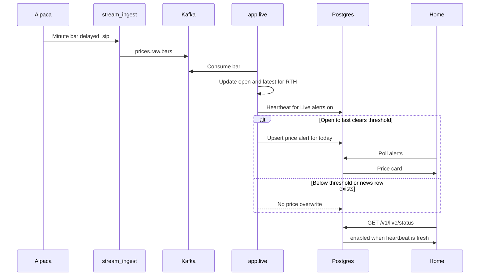
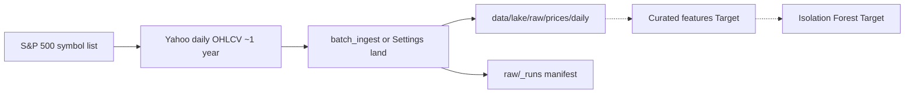
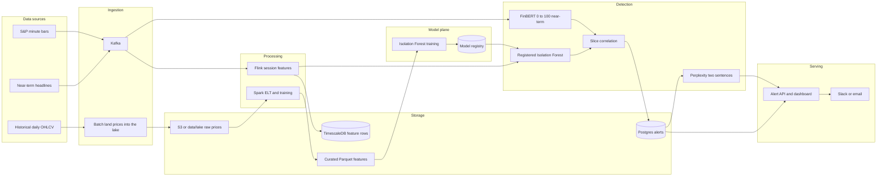
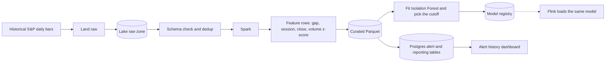
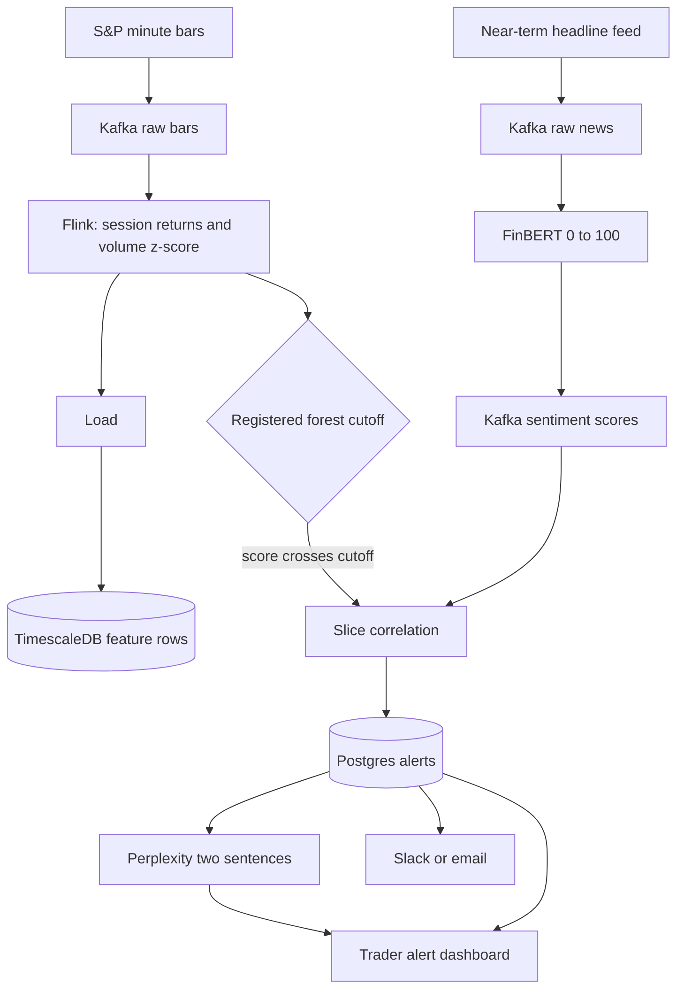
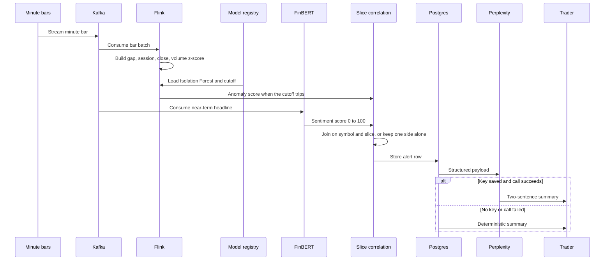

# S&P 500 Alert System architecture

Local decision-support service for the **S&P 500**. A watchlist of index constituents becomes one alert per symbol per day: a price move, a news-sentiment alert, or a news + price alert when both rules fire.

The class design (CISC 525) is a lambda architecture: Kafka and Flink on the live path, Spark and a data lake on the historical **price** path, FinBERT for near-term headline sentiment, an Isolation Forest trained on lake price/volume features, and Perplexity for the alert wording. The plan is [proposal-pipeline-audit.md](proposal-pipeline-audit.md).

This repository runs:

- Alpaca delayed SIP minute bars onto Kafka (`stream_ingest/`)
- A FastAPI consumer (`python -m app.live`) that writes open→last **price** alerts for the watchlist
- Yahoo daily bars and FinBERT headlines on **Run check** (near-term news only)
- A Perplexity summary when a key is saved
- A batch land of about one year of S&P daily prices into the lake (`batch_ingest/` or Settings → Historical prices)

Flink scoring and Isolation Forest training complete the class stack on that lake and Kafka path. **Historical headlines are not landed and are not training features.** News stays on the near-term check (and, in the class stream diagram, a live headline topic). There is no shared package with Vajra Astra Capital.

## Status

| Capability | Status |
|---|---|
| Watchlist of S&P 500 constituents (focus set for Run check, rebuild, and live price alerts), with ticker and company-name search. Add accepts index constituents only | **As-built** |
| Yahoo daily bars into `daily_bars` for a check | **As-built** |
| Near-term Yahoo headlines scored with local FinBERT (0–100), with confidence and class shares | **As-built** |
| Price alert: open→last while the market is open; close versus prior close after the close. Volume spike note on the completed close | **As-built** |
| News alert and news + price when the headline’s price slice clears the same percent | **As-built** |
| Plain-English summary; Perplexity two sentences when a key is saved | **As-built** |
| Home inbox, Alert History, saved thresholds, admin rebuild of recent sessions | **As-built** |
| Minute bars on Kafka from Alpaca `delayed_sip` (WebSocket ≤30 on Basic; REST fills the rest of the S&P 500) | **As-built** |
| Live Kafka consumer: open→last price alerts (`python -m app.live`); Home “Live alerts on” heartbeat | **As-built** |
| Historical Yahoo daily bars for the S&P 500 (~1 year) in the lake raw zone | **As-built** |
| Spark curated feature table (gap, session, close, volume z-score) and Isolation Forest registry | **Target** |
| Flink scores the registered forest on live session features; Timescale feature sink | **Target** |
| Near-term headline topic on Kafka with FinBERT scores for live slice join | **Target** |
| Slack or email after the alert row exists | **Target** |

Dropped from both the running design and the class target: Cassandra, FinBERT fine-tuning, VWAP as a stream stage, a generic LLM box, a historical news lake, and sentiment features inside Isolation Forest training.

A normal check writes the current Eastern trading day. The admin rebuild deletes saved alerts and reapplies rules over the last 1–40 calendar days for the watchlist. It is not the training lake. Model training reads lake Parquet, not the rebuild.

## Proposal audit

[proposal-pipeline-audit.md](proposal-pipeline-audit.md) is the revised plan. The mermaid diagrams below are that target. Cassandra, FinBERT fine-tune, VWAP, and a generic LLM box are gone. Historical news is not part of the batch lake.

Spark lands **historical S&P daily prices** in the lake, builds one price/volume feature row per symbol per session, and fits an Isolation Forest. The registry holds that model, the feature list, and the score cutoff. Flink scores the same vector on live minute bars from Kafka and writes feature rows to TimescaleDB. FinBERT scores **near-term** headlines (check today; live news topic on the class stream). Correlation joins a headline to the slice in progress and allows news-only and price-only. Perplexity writes two sentences after the row exists. Postgres is the alert of record.

### What this repository does

| Class target | This app |
|---|---|
| Minute bars on Kafka, scored by the registered forest | Minute bars on Kafka from Alpaca. `python -m app.live` applies the open→last percent rule and writes a **price** row. Forest scoring uses the same lake features once the model is registered |
| FinBERT on near-term headlines | FinBERT on each headline during a check. Weights on this machine. No historical news land |
| Slice join, news-only and price-only | Same Eastern day; gap, session, or close slice. Fusion only when that slice clears the price rule |
| Perplexity after the decision | When a key is saved; model name under Together; deterministic fallback |
| Lake, Spark training, registry | Raw daily prices under `data/lake/raw/` via `batch_ingest` or Settings. Curated features and forest training read that lake. Headlines are not in the batch land |
| One alert per symbol per day | One row per symbol per day |

## As-built check

**Run check** or rebuild. Live Kafka price path is the next diagram.

## As-built live price stream

Docker Kafka, Alpaca producer, and `python -m app.live`. Writes **price** alerts. News comes from Run check. Home reads `/v1/live/status`.

## As-built batch lake land

S&P 500 daily prices only. No historical headlines.

## Revised target: high-level lambda architecture

Batch trains on **price history**. Stream applies that model and scores **near-term** news. No historical news lake.

## Revised target: batch historical ELT

Land raw **prices**, build price/volume features, fit the forest. FinBERT is not fine-tuned and is not a batch input.

## Revised target: streaming ETL

Minute bars scored by the registered forest. Near-term headlines scored by FinBERT. Postgres holds the alert. Perplexity writes after the row exists.

## Revised target: end-to-end alert sequence

Price-only and news-only are allowed. Perplexity never decides the alert. The forest features are price and volume only.

## Local schema

`watchlist` holds S&P 500 symbols a check will refresh. `symbols` caches the Yahoo sector or fund category. `daily_bars` and `headlines` are check inputs (near-term headlines only). `app_settings` stores the price fraction, the FinBERT sentiment threshold, the optional Perplexity API key, the selected Perplexity model, and `live_consumer_heartbeat_at` for the Home live cue. The default threshold is 25 points from 50. The default model is `openai/gpt-5.4-mini`. `alerts.kind` is `price`, `news`, or `news_price`.

One row per symbol per `bar_date`. A repeated check replaces that day's alert and keeps `created_at`. The row also stores `price_move_threshold` and `sentiment_threshold` from the moment it fired. When Perplexity rewrites Together, the alert `sections` keep the rule sentence, the model id, and the model label shown under Together. A headline is eligible only when it was published on that Eastern trading day and is inside the news lookback.

`sentiment_scorer` stays `finbert`. FinBERT loads ProsusAI/finbert on this machine. The stored score is 0 to 100, with 50 neutral. Confidence is the winning class probability. A headline is eligible when the score is at least the saved number of points from 50.

The lake under `data/lake/raw/prices/daily/` holds historical daily OHLCV for training. It is separate from Postgres alerts.
