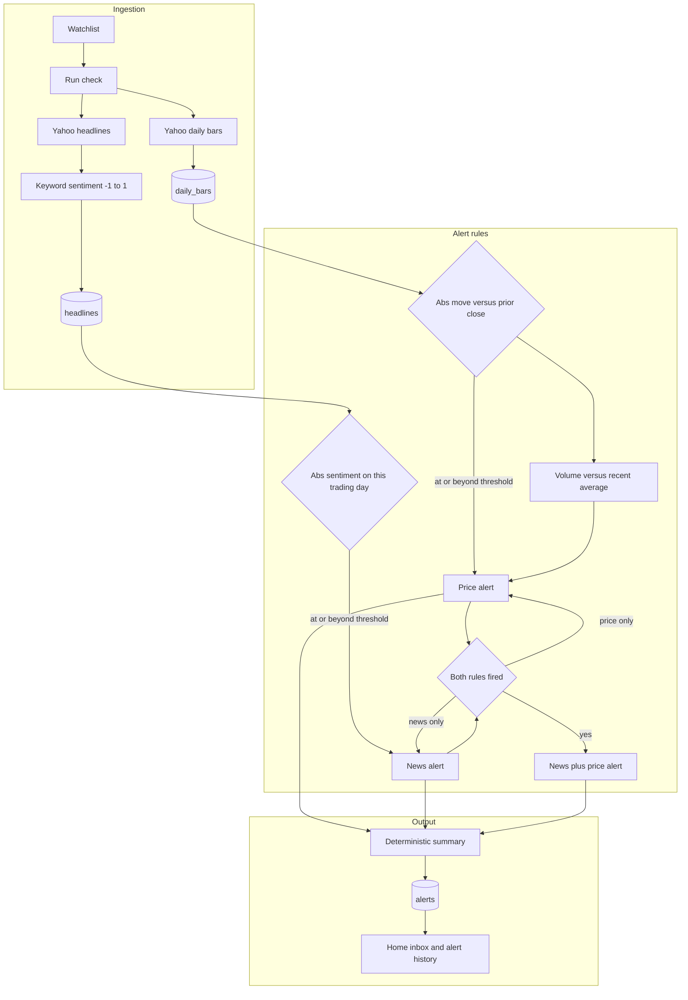
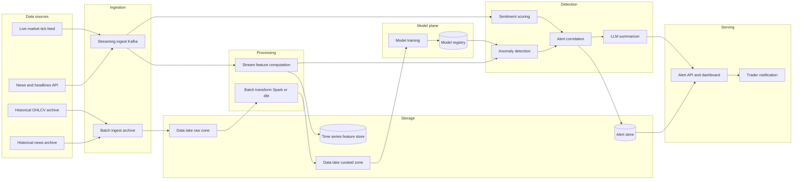
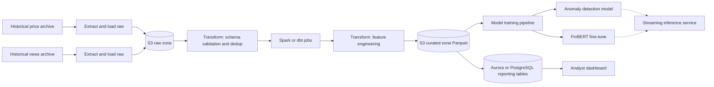
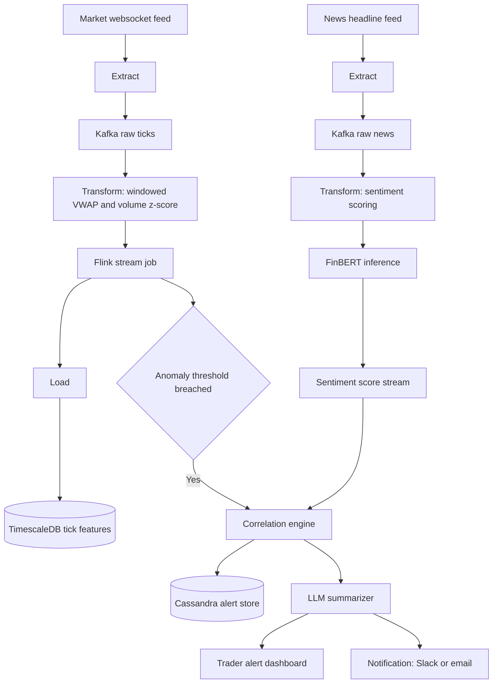
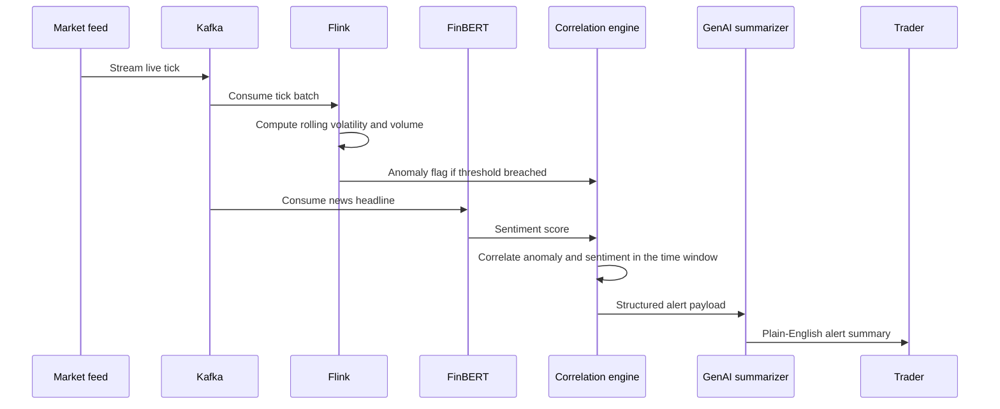

# Ticker Alert System architecture

Local decision-support service that turns a watchlist into one alert per symbol per day: a price move, a news-sentiment alert, or a news + price alert when both rules fire.

The class design (CISC 525) is a lambda architecture: Kafka and Flink on the live path, Spark and a data lake on the historical path, FinBERT for sentiment, and a model registry for anomaly thresholds. This repository documents that target and runs a smaller path that matches the Vajra Astra shape: FastAPI, PostgreSQL, Yahoo daily bars, and the keyword sentiment scorer.

There is no shared package with Vajra Astra Capital. Common logic lives in this repo as its own copy.

## Status

| Capability | Status |
|---|---|
| Watchlist of tickers | **As-built** |
| Yahoo daily bars into `daily_bars` | **As-built** |
| Yahoo headlines scored with the keyword lexicon | **As-built** |
| Price alert: percent change versus the prior close, with a volume-spike flag | **As-built** |
| News alert: absolute sentiment at or beyond the configured threshold, on that headline's trading day | **As-built** |
| News plus price only when both rules fire for the same trading day | **As-built** |
| Plain-English summary from the alert fields, including the thresholds in force when it fired | **As-built** |
| Home inbox of alerts since the app was last opened, plus a sortable alert history | **As-built** |
| Saved price and sentiment thresholds | **As-built** |
| Admin rebuild: wipe alerts and rerun the current rules over the last 1–40 calendar days | **As-built** |
| Symbol links to the Yahoo Finance quote, from Home, History, and the details title | **As-built** |
| Live tick websocket (Alpaca / Databento) | **Target** |
| Kafka topics and Flink windowed VWAP / volume z-score | **Target** |
| FinBERT inference | **Target** |
| Isolation Forest training on the historical lake | **Target** |
| Correlation of a tick anomaly and a sentiment score inside a sub-minute window | **Target** |
| LLM explanation of an alert | **Target** |
| Slack or email notification | **Target** |

A normal check writes only the current Eastern trading day. The admin rebuild is the historical pass we can run now: it deletes saved alerts and reapplies the current rules to each session in the chosen window. It is not the proposal's training lake. Yahoo does not return a full headline archive, so a rebuild can rescore price history and only the headlines already stored or still on Yahoo's recent list.

## Proposal audit

The class deck (CISC 525, 30 Aug 2026) asks for a lambda system: live ticks and a news firehose on a streaming path, historical OHLCV and labeled headlines on a batch path, then a correlation step that explains an anomaly with nearby sentiment. The diagrams in that deck are the target diagrams below. This section is the gap between that proposal and this repository.

### What the correlation engine was for

The streaming diagram does not alert the trader from either stream alone. Flink raises a flag only when an anomaly threshold is breached. FinBERT emits a sentiment score stream. Both outputs go into the correlation engine, which keeps them only when they refer to the same symbol inside one time window, then hands that pair to the summarizer.

That join is the product. A price spike with no story, and a headline with no unusual tape, stay inside the pipeline. The trader is supposed to see "this move happened, and this news is the candidate reason."

The deck never defines the window, the symbol match, or what happens when only one side arrives. The sequence diagram always shows both a tick and a headline.

### Where the proposal is thin

- The anomaly is described two ways. The objective says a statistically significant price or volume move. The stack says Isolation Forest. The streaming diagram says a threshold gate. Those are not the same detector, and the deck does not say which one the correlation engine waits for.
- The time window is unnamed. A few seconds would miss a headline that prints after the close. A whole day will mix a later story with an earlier move. The LITE case in this app is that mix.
- Late news, disagreeing tone, and several headlines for one move are not specified. The engine is drawn as a single arrow.
- The batch path trains models and calibrates thresholds. It is not drawn as a way to rebuild the alert table. Using it as "historical updates" would still need a replay job the deck does not specify.
- Historical news is assumed to exist as an archive. The live news box is a firehose. Neither is the recent-list feed this app can actually call.
- The serving path writes TimescaleDB, Cassandra, Aurora, and S3. The deck does not say which store is the alert of record.
- The no-code slide claims a regulatory audit trail and latency SLAs. The rest of the deck does not define either.
- Kafka, Flink, and FinBERT are the critical path, and the same deck marks them as the skills still being learned.

### What this repository does instead

| Proposal | This app |
|---|---|
| Tick stream, anomaly within seconds | One daily close versus the prior close. A volume spike is a note, not a separate detector |
| FinBERT score stream | Keyword score, default absolute threshold 0.34 |
| Correlation window, unspecified | Same Eastern trading day. Weekend stories stay with Friday. A next-morning story does not attach to the prior close |
| Alert only when both sides meet | Price only, news only, or news + price |
| LLM summary | Deterministic sentences, plus the thresholds saved on the alert |
| Historical lake and backtesting | Admin rebuild of the last 1–40 calendar days from Yahoo bars and stored headlines. Current settings are applied again, and previous alerts are deleted |
| Many alerts per symbol per session | One row per symbol per day |

The rebuild is the closest thing we have to the historical path. It replays rules. It does not train a model or tune a threshold.

## As-built check

## Target: high-level lambda architecture

Streaming path for live detection. Batch path for training and historical reporting. This is the CISC 525 target. It is not what the local process runs today.

## Target: batch historical ELT

Extract and load raw history, then transform in the lake.

## Target: streaming ETL

Extract live ticks and headlines, transform in flight, then load curated results.

## Target: end-to-end alert sequence

## Local schema

`watchlist` holds the symbols a check will refresh. `symbols` caches the Yahoo sector name. `daily_bars` and `headlines` are the inputs. `app_settings` stores the price fraction and the sentiment threshold. `alerts.kind` is `price`, `news`, or `news_price`.

One row per symbol per `bar_date`. A repeated check replaces that day's alert and keeps `created_at`. The row also stores `price_move_threshold` and `sentiment_threshold` from the moment it fired. A headline is eligible only when it was published on that Eastern trading day and is inside the news lookback.
