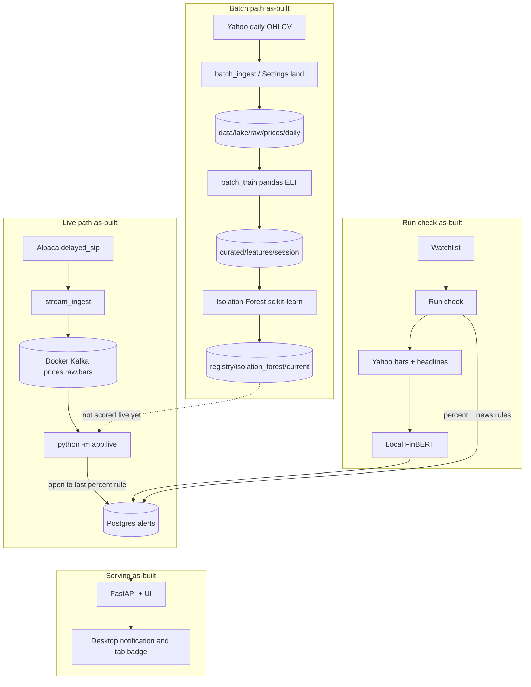
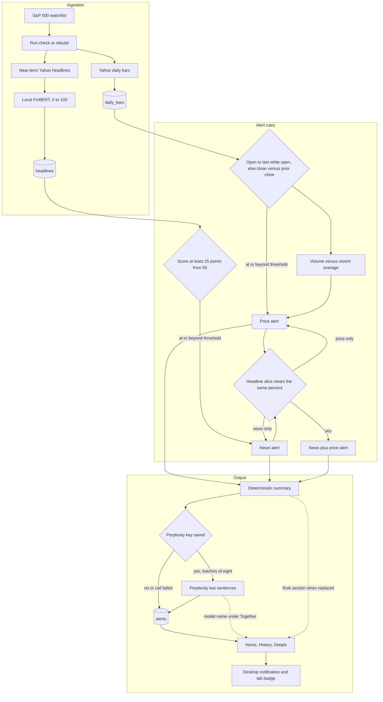
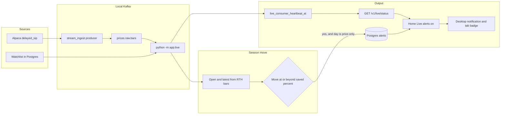
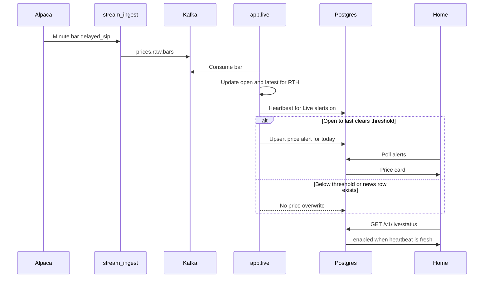
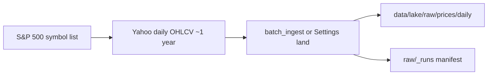
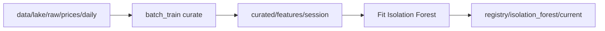
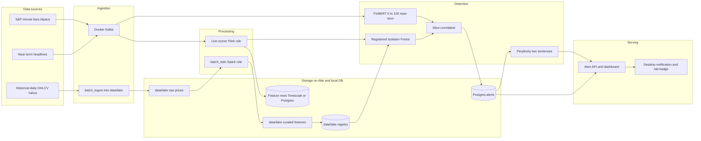
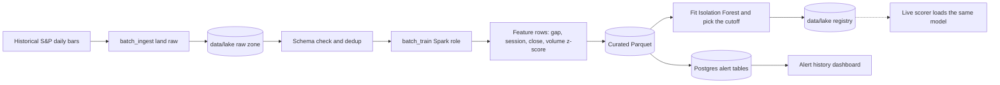
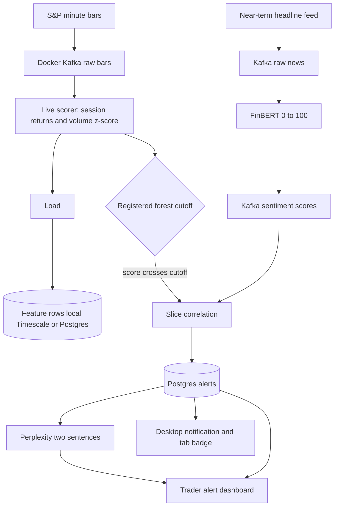
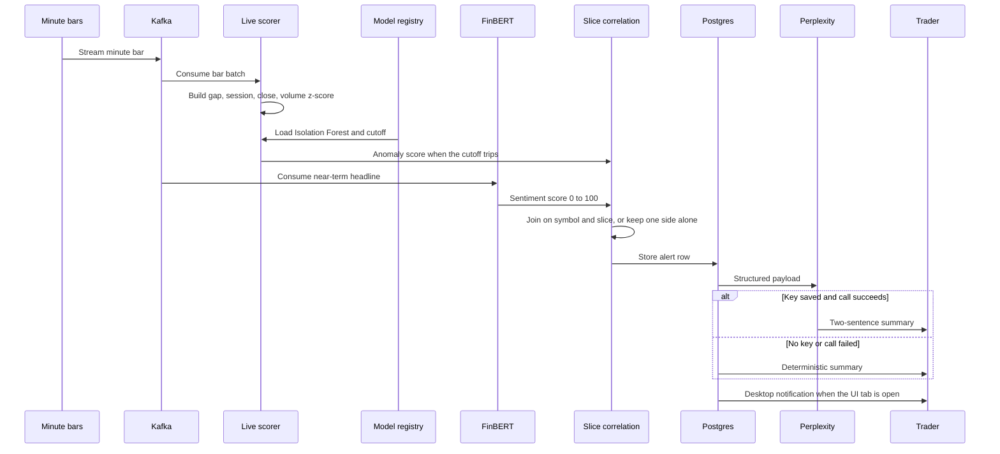

# S&P 500 Alert System architecture

Local decision-support service for the **S&P 500**. A watchlist of index constituents becomes one alert per symbol per day: a price move, a news-sentiment alert, or a news + price alert when both rules fire.

The class design (CISC 525) is a **local** lambda architecture: Docker Kafka on the live path, a batch lake on disk, a Spark-**role** training job, FinBERT for near-term headline sentiment, an Isolation Forest trained on lake price/volume features, and Perplexity for the alert wording. The plan is [proposal-pipeline-audit.md](proposal-pipeline-audit.md).

**Deploy target:** one developer machine (Docker Desktop + Postgres + local lake). Cloud names from the original deck (S3, Aurora, managed Flink) map to local stand-ins below. This project does **not** require an AWS production deploy for the class demo.

This repository runs today:

- Alpaca delayed SIP minute bars onto local Kafka (`stream_ingest/`)
- A FastAPI consumer (`python -m app.live`) that writes open→last **price** alerts for the watchlist (percent rule)
- Yahoo daily bars and FinBERT headlines on **Run check** (near-term news only)
- A Perplexity summary when a key is saved
- Batch land of about one year of S&P daily prices into `data/lake/raw/` (`batch_ingest/` or Settings)
- Curated session features + Isolation Forest registry (`batch_train/`)
- Mac/Chrome desktop notifications and a tab badge when new alerts arrive

Still open for the **local final** stack: score live Kafka sessions with the registered forest (Flink **role**), optional Timescale/Postgres feature-row sink, and a near-term news topic on Kafka. **Historical headlines are not landed and are not training features.** There is no shared package with Vajra Astra Capital.

## Status

| Capability | Status |
|---|---|
| Watchlist of S&P 500 constituents (focus set for Run check, rebuild, and live price alerts), with ticker and company-name search. Add accepts index constituents only | **As-built** |
| Yahoo daily bars into `daily_bars` for a check | **As-built** |
| Near-term Yahoo headlines scored with local FinBERT (0–100), with confidence and class shares | **As-built** |
| Price alert: open→last while the market is open; close versus prior close after the close. Volume spike note on the completed close | **As-built** |
| News alert and news + price when the headline’s price slice clears the same percent | **As-built** |
| Plain-English summary; Perplexity two sentences when a key is saved | **As-built** |
| Home inbox, Alert History, saved thresholds, admin rebuild of recent sessions | **As-built** |
| Minute bars on Kafka from Alpaca `delayed_sip` (WebSocket ≤30 on Basic; REST fills the rest of the S&P 500) | **As-built** |
| Live Kafka consumer: open→last price alerts (`python -m app.live`); Home “Live alerts on” heartbeat | **As-built** |
| Historical Yahoo daily bars for the S&P 500 (~1 year) in the lake raw zone | **As-built** |
| Spark-role curated feature table (gap, session, close, volume z-score) and Isolation Forest registry via `batch_train` (local pandas/scikit-learn) | **As-built** |
| Mac/Chrome desktop notification (Notification Center) plus tab title/favicon badge when new alerts arrive from Run check or live | **As-built** |
| Live scorer loads the registry and scores session features from Kafka bars (Flink role); feature-row sink | **Local final target** |
| Near-term headline topic on Kafka with FinBERT scores for live slice join | **Local final target** |

Dropped from both the running design and the local final target: Cassandra, FinBERT fine-tuning, VWAP as a stream stage, a generic LLM box, a historical news lake, sentiment features inside Isolation Forest training, and a mandatory AWS production deploy.

A normal check writes the current Eastern trading day. The admin rebuild deletes saved alerts and reapplies rules over the last 1–40 calendar days for the watchlist. It is not the training lake. Model training reads lake Parquet, not the rebuild.

## Proposal audit

[proposal-pipeline-audit.md](proposal-pipeline-audit.md) is the revised plan. Diagrams below separate **as-built** (running now) from **local final target** (still to wire on this machine). Cassandra, FinBERT fine-tune, VWAP, and a generic LLM box are gone. Historical news is not part of the batch lake. S3/Aurora on older slides mean `data/lake` and local Postgres.

### What this repository does

| Local final target | This app today |
|---|---|
| Minute bars on Kafka, scored by the registered forest | Minute bars on Kafka from Alpaca. `python -m app.live` applies the open→last **percent** rule. Forest scoring from the registry is the remaining live gap |
| FinBERT on near-term headlines | FinBERT on each headline during a check. Weights on this machine. No historical news land |
| Slice join, news-only and price-only | Same Eastern day; gap, session, or close slice. Fusion only when that slice clears the price rule |
| Perplexity after the decision | When a key is saved; model name under Together; deterministic fallback |
| Lake, Spark-role training, registry | Raw under `data/lake/raw/` via `batch_ingest`. `batch_train` writes curated features and `data/lake/registry/isolation_forest/current/` |
| One alert per symbol per day | One row per symbol per day |
| Notify the trader after the row exists | OS desktop notification + tab badge (`ui/sw-notifications.js`). Slack and email are not used |

### Local stand-ins (no AWS required)

| Original deck / cloud name | Local stand-in in this repo |
|---|---|
| S3 data lake | `data/lake/` Parquet on disk |
| Aurora / RDS | Local Postgres `ticker_alert_db` |
| Managed Kafka | Docker Compose Kafka |
| Spark cluster (EMR / Dataproc) | `batch_train` Spark-**role** job (pandas ELT + scikit-learn Isolation Forest) |
| Flink on Kinesis/MSK | Local Flink-**role** live scorer (next): same four features + registry cutoff |
| Timescale (managed) | Local Timescale in Docker, or a Postgres feature-row table |
| Slack / email | Mac/Chrome desktop notification + tab badge |

## As-built: system overview

Everything that runs on one machine today. Live price alerts still use the **percent rule**; the forest is trained but not yet applied on the Kafka path.

## As-built check

**Run check** or rebuild. Live Kafka price path is the next diagram.

Home asks for notification permission (Enable desktop notifications). When Run check or a live refresh adds alert rows, the open tab raises a Mac/Chrome Notification Center popup and sets `(N)` on the title with a favicon badge. Opening Home clears the unread count. Slack and email are not used.

## As-built live price stream

Docker Kafka, Alpaca producer, and `python -m app.live`. Writes **price** alerts with the **percent rule**. News comes from Run check. Home reads `/v1/live/status`.

## As-built batch lake land

S&P 500 daily prices only. No historical headlines. Local disk lake (S3 stand-in).

## As-built curated features and Isolation Forest

Local Spark-**role** job [`batch_train`](../batch_train/): pandas ELT + scikit-learn Isolation Forest. Four price/volume features only. Registry under `data/lake/registry/isolation_forest/current/`. Not a Dataproc/EMR cluster; same *job* the diagrams call Spark training.

## Local final target: high-level lambda architecture

Batch trains on **price history** (as-built). Stream applies that model and scores **near-term** news (remaining). Everything stays on the local machine. No historical news lake. No AWS requirement.

## Local final target: batch historical ELT

Land raw **prices**, build price/volume features, fit the forest. FinBERT is not fine-tuned and is not a batch input. **This path is as-built** via `batch_ingest` + `batch_train`.

## Local final target: streaming ETL

Minute bars scored by the registered forest. Near-term headlines scored by FinBERT. Postgres holds the alert. Perplexity writes after the row exists. **Percent-rule live path is as-built; forest scoring and live news topic are the remaining gap.**

## Local final target: end-to-end alert sequence

Price-only and news-only are allowed. Perplexity never decides the alert. The forest features are price and volume only.

## Local schema

`watchlist` holds S&P 500 symbols a check will refresh. `symbols` caches the Yahoo sector or fund category. `daily_bars` and `headlines` are check inputs (near-term headlines only). `app_settings` stores the price fraction, the FinBERT sentiment threshold, the optional Perplexity API key, the selected Perplexity model, and `live_consumer_heartbeat_at` for the Home live cue. The default threshold is 25 points from 50. The default model is `openai/gpt-5.4-mini`. `alerts.kind` is `price`, `news`, or `news_price`.

One row per symbol per `bar_date`. A repeated check replaces that day's alert and keeps `created_at`. The row also stores `price_move_threshold` and `sentiment_threshold` from the moment it fired. When Perplexity rewrites Together, the alert `sections` keep the rule sentence, the model id, and the model label shown under Together. A headline is eligible only when it was published on that Eastern trading day and is inside the news lookback.

`sentiment_scorer` stays `finbert`. FinBERT loads ProsusAI/finbert on this machine. The stored score is 0 to 100, with 50 neutral. Confidence is the winning class probability. A headline is eligible when the score is at least the saved number of points from 50.

The lake under `data/lake/` holds raw daily OHLCV, curated session features, and the Isolation Forest registry. It is separate from Postgres alerts.
