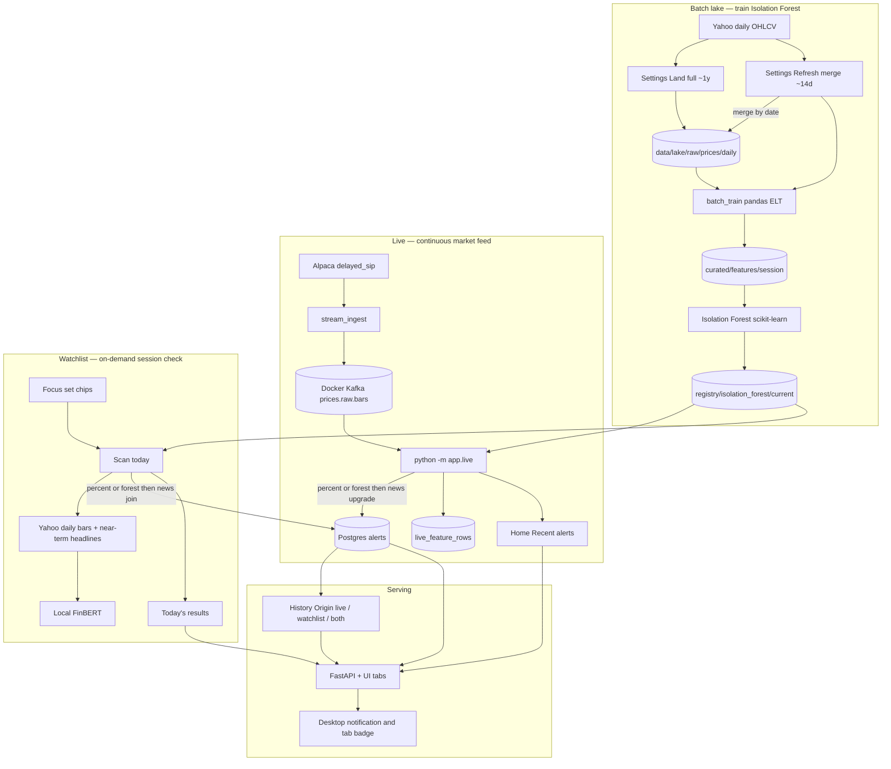
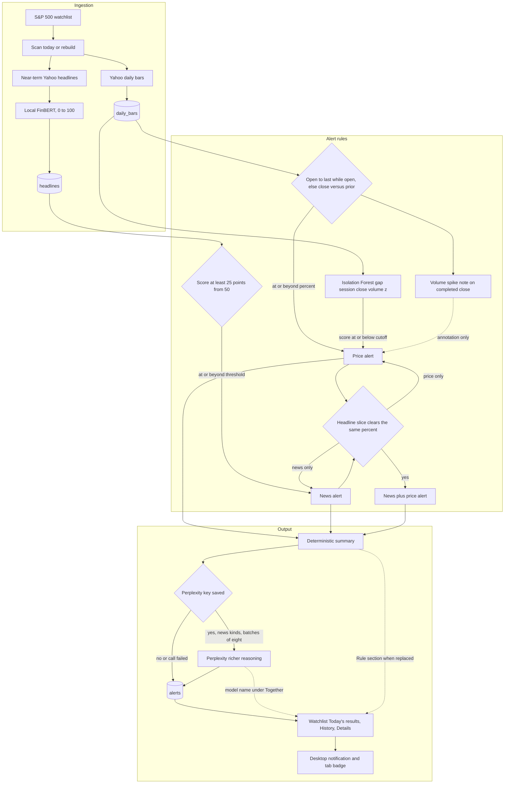
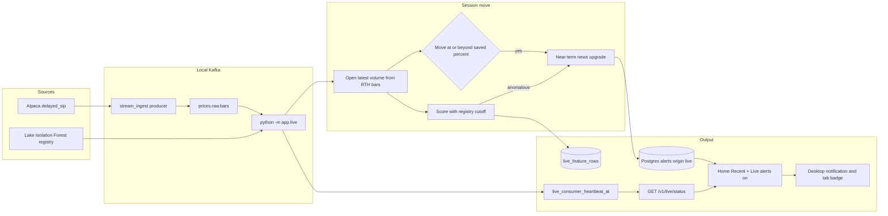
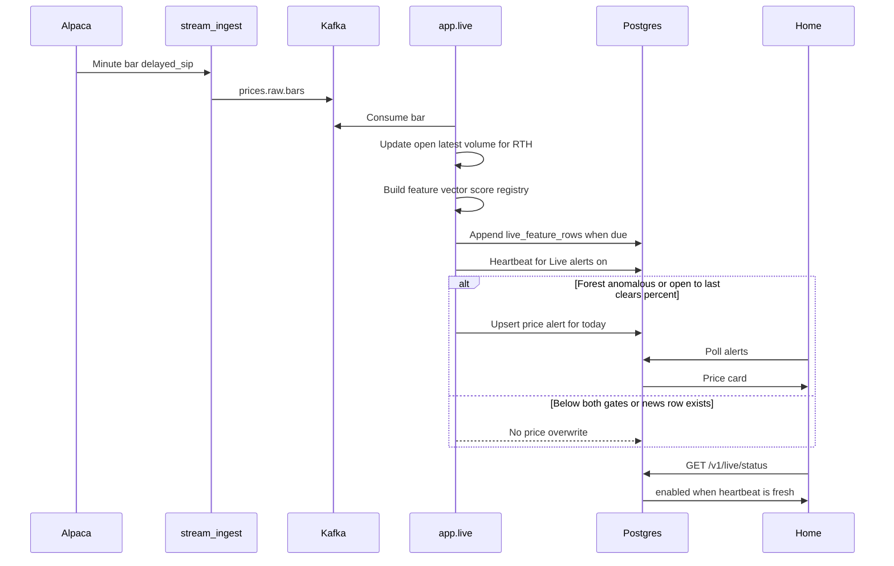
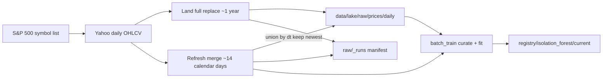
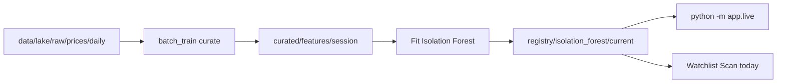
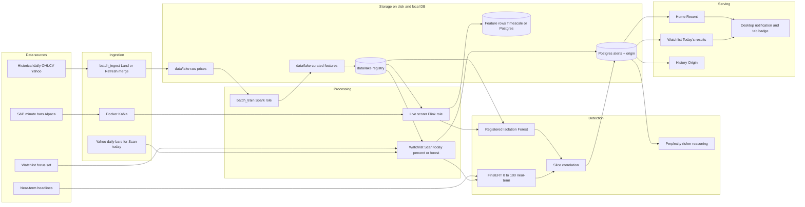
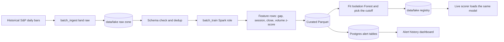
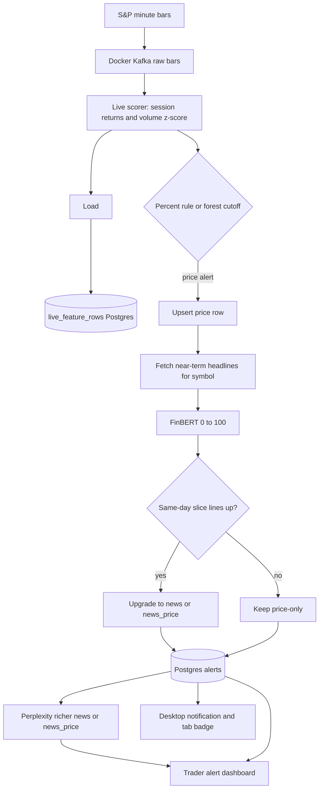
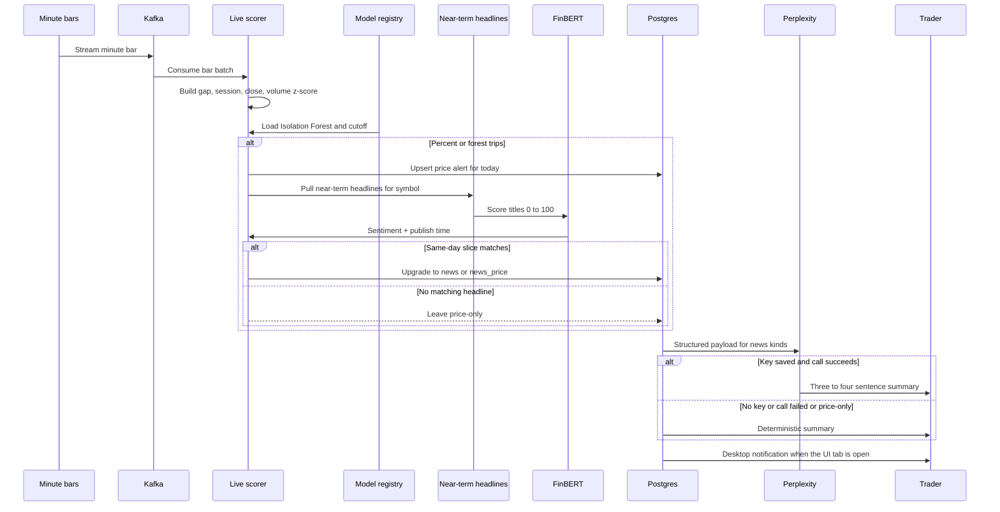

# S&P 500 Alert System architecture

Local decision-support service for the **S&P 500**. One alert per symbol per day: a price move, a news-sentiment alert, or a news + price alert when both rules fire.

Two product paths sit side by side:

- **Live** — continuous Kafka minute bars → Home **Recent** (market awareness while the session is open).
- **Watchlist** — a focus set of index constituents plus on-demand **Scan today** → Watchlist **Today's results** (session / day review under current rules, including after the close).

Both write the same Postgres `alerts` table. History shows an **Origin** column (`live` / `watchlist` / `both`). The **batch lake** (`batch_ingest` + `batch_train`) trains Isolation Forest on historical prices; it is not the Watchlist UI. Watchlist Scan today is the useful product pass over **today’s** daily bars and near-term headlines for the focus set.

The class design (CISC 525) is a **local** lambda architecture: Docker Kafka on the live path, a batch lake on disk, a Spark-**role** training job, FinBERT for near-term headline sentiment, an Isolation Forest trained on lake price/volume features, and Perplexity for the alert wording. The plan is [proposal-pipeline-audit.md](proposal-pipeline-audit.md).

**Deploy target:** one developer machine (Docker Desktop + Postgres + local lake). Cloud names from the original deck (S3, Aurora, managed Flink) map to local stand-ins below. This project does **not** require an AWS production deploy for the class demo.

This repository runs today:

- Alpaca delayed SIP minute bars onto local Kafka (`stream_ingest/`)
- A FastAPI consumer (`python -m app.live`) that writes open→last **price** alerts from the stream (percent rule **or** registered Isolation Forest when the lake registry is present), then upgrades with near-term news when the slice matches
- Live feature vectors + forest scores into Postgres `live_feature_rows` (Timescale stand-in)
- **Watchlist** tab: focus-set search, **Scan today** over Yahoo daily bars + FinBERT headlines — same **percent or forest** price gate as live, then the news join; Today's results separate from Home Recent
- Perplexity richer reasoning for news / news+price when a key is saved (price-only stays deterministic); forest-aware deterministic wording when Isolation Forest fires; granular evidence story on Home, Watchlist, and Details
- Batch land of about one year of S&P daily prices into `data/lake/raw/` (`batch_ingest/` or Settings **Land**) for **model training**
- Incremental **Refresh lake + retrain** (merge ~14 calendar days + `batch_train`) so the registry is not stuck on a stale land
- Curated session features + Isolation Forest registry (`batch_train/`) — used by **both** Live and Watchlist Scan today
- Alert History with Origin + draggable columns; Mac/Chrome desktop notifications and a tab badge when new alerts arrive

Still open for the **local final** stack: an optional near-term news **topic on Kafka** (deferred — today live and Scan today fetch Yahoo headlines directly). Forest-aware price-only wording, Watchlist forest parity, incremental lake refresh + retrain, live price → news upgrade, and the evidence-story popup are as-built. **Historical headlines are not landed and are not training features.** There is no shared package with Vajra Astra Capital.

## Status

| Capability | Status |
|---|---|
| Watchlist tab: S&P 500 focus set (search + chips), Scan today, Today's results separate from Home Recent | **As-built** |
| Home tab: **Recent alerts** feed with S&P 500 / Watchlist scope switch; Clear alerts; desktop notification controls | **As-built** |
| History tab: full list with Origin (`live` / `watchlist` / `both`), sortable + draggable columns | **As-built** |
| Yahoo daily bars into `daily_bars` for Watchlist Scan today / rebuild (session-day product pass) | **As-built** |
| Near-term Yahoo headlines scored with local FinBERT (0–100), with confidence and class shares | **As-built** |
| Price alert: open→last while the market is open; close versus prior close after the close. Volume spike note on the completed close | **As-built** |
| News alert and news + price when the headline’s price slice clears the same percent | **As-built** |
| Plain-English summary; Perplexity richer news / news+price reasoning when a key is saved (price-only stays deterministic) | **As-built** |
| Saved thresholds; admin rebuild of recent sessions for the watchlist | **As-built** |
| Minute bars on Kafka from Alpaca `delayed_sip` (WebSocket ≤30 on Basic; REST fills the rest of the S&P 500) | **As-built** |
| Live Kafka consumer: open→last price alerts (`python -m app.live`); Home “Live alerts on” heartbeat | **As-built** |
| Historical Yahoo daily bars for the S&P 500 (~1 year) in the lake raw zone (**training lake**, not the Watchlist UI) | **As-built** |
| Incremental lake refresh: merge last ~14 calendar days of Yahoo dailies into Parquet, then `batch_train` (Settings **Refresh lake + retrain** / CLI) so the registry is not stuck on a stale land | **As-built** |
| Spark-role curated feature table (gap, session, close, volume z-score) and Isolation Forest registry via `batch_train` (local pandas/scikit-learn) | **As-built** |
| Live scorer loads the registry and scores session features from Kafka bars (Flink role); Postgres `live_feature_rows` sink | **As-built** |
| Watchlist Scan today / rebuild uses the same Isolation Forest registry (percent **or** forest) before the news join | **As-built** |
| Mac/Chrome desktop notification (Notification Center) plus tab title/favicon badge when new alerts arrive from Scan today or live | **As-built** |
| Live price → near-term news: after a percent or forest price alert, fetch/score headlines and upgrade to news / news+price when the same-day slice matches; Perplexity on news kinds | **As-built** |
| Evidence story with granular second-side alignment (supports / somewhat supports / neutral / disagrees / contradicts) on Home, Watchlist, and Details | **As-built** |
| Richer forest-aware price-only wording (deterministic Summary / Price / Forest / What happened when Isolation Forest fires; percent status + feature drivers; still no Perplexity on bare price-only) | **As-built** |
| Near-term news topic on Kafka with FinBERT scores (optional bus; deferred — live and Scan today fetch Yahoo near-term headlines today) | **Local final target (deferred)** |

Dropped from both the running design and the local final target: Cassandra, FinBERT fine-tuning, VWAP as a stream stage, a generic LLM box, a historical news lake, sentiment features inside Isolation Forest training, and a mandatory AWS production deploy.

A normal check writes the current Eastern trading day. The admin rebuild deletes saved alerts and reapplies rules over the last 1–40 calendar days for the watchlist. It is not the training lake. Model training reads lake Parquet, not the rebuild.

## Proposal audit

[proposal-pipeline-audit.md](proposal-pipeline-audit.md) is the revised plan. Diagrams below separate **as-built** (running now) from **local final target** (still to wire on this machine). Cassandra, FinBERT fine-tune, VWAP, and a generic LLM box are gone. Historical news is not part of the batch lake. S3/Aurora on older slides mean `data/lake` and local Postgres.

### What this repository does

| Local final target | This app today |
|---|---|
| Minute bars on Kafka, scored by the registered forest | Minute bars on Kafka from Alpaca. `python -m app.live` applies the open→last **percent** rule and scores session features with the registered Isolation Forest; rows land in `live_feature_rows` |
| FinBERT on near-term headlines | FinBERT on Watchlist Scan today and after a live price / forest alert. Weights on this machine. No historical news land |
| Slice join, news-only and price-only | Same Eastern day; gap, session, or close slice. Live and Scan today: price first, then news when the slice matches; news-only still allowed on Scan today |
| Watchlist focus set beside the live feed | Watchlist tab for Scan today / Today's results; Home Recent for live; History Origin distinguishes the writer |
| Perplexity after the decision | When a key is saved for news / news+price; model name under Together; price-only keeps the rule sentence |
| Lake, Spark-role training, registry | Raw under `data/lake/raw/` via `batch_ingest` **Land** (full) or **Refresh** (merge ~14d + retrain). `batch_train` writes curated features and `data/lake/registry/isolation_forest/current/`. Live and Scan today both score with that registry |
| One alert per symbol per day | One row per symbol per day (`alerts.origin` tracks live / watchlist / both) |
| Notify the trader after the row exists | OS desktop notification + tab badge (`ui/sw-notifications.js`). Slack and email are not used |

### Local stand-ins (no AWS required)

| Original deck / cloud name | Local stand-in in this repo |
|---|---|
| S3 data lake | `data/lake/` Parquet on disk |
| Aurora / RDS | Local Postgres `ticker_alert_db` |
| Managed Kafka | Docker Compose Kafka |
| Spark cluster (EMR / Dataproc) | `batch_train` Spark-**role** job (pandas ELT + scikit-learn Isolation Forest) |
| Flink on Kinesis/MSK | Local Flink-**role** live scorer in `python -m app.live`: same four features + registry cutoff |
| Timescale (managed) | Postgres `live_feature_rows` (Timescale stand-in) |
| Slack / email | Mac/Chrome desktop notification + tab badge |

## As-built: system overview

Everything that runs on one machine today. Three paths stay distinct: the **training lake**, **Live** (continuous), and **Watchlist Scan today** (on-demand session pass). Live and Scan today both use the **percent rule or** the registered Isolation Forest (same lake registry) as the price gate, then the news join.

## As-built: Live and Watchlist side by side

| | Live | Watchlist Scan today |
|---|---|---|
| Job | Continuous awareness while RTH is open | Deliberate review of the focus set under **current** rules |
| UI | Home → **Recent alerts** (scope: full S&P 500 or Watchlist only) | Watchlist → chips + **Scan today** → **Today's results** |
| Inputs | Kafka minute bars (+ near-term Yahoo headlines after a price/forest hit) | Yahoo `daily_bars` + near-term headlines for watchlist symbols |
| Price gate | open→last **percent or** Isolation Forest (lake registry) | Same **percent or** Isolation Forest on the day’s session vector |
| When it shines | Deployed day; laptop left open on the stream | After the close; after changing Settings; catch-up if live was down; class demo without Kafka |
| Origin on the row | `live` (or `both` if Scan today also wrote the day) | `watchlist` (or `both` if live also wrote the day) |

The lake batch path does **not** replace Watchlist. Lake Parquet trains the forest. Watchlist Scan today is the product pass over **this session’s** bars and headlines for names you care about.

## As-built Watchlist Scan today

**Scan today** or rebuild on the Watchlist tab. Live Kafka price path is the next diagram.

Home asks for notification permission (Enable desktop notifications). When Scan today or a live refresh adds alert rows, the open tab raises a Mac/Chrome Notification Center popup and sets `(N)` on the title with a favicon badge. Opening Home clears the unread count. Scan today results stay on the Watchlist tab so Home Recent is not overwritten. Slack and email are not used.

## As-built live price stream

Docker Kafka, Alpaca producer, and `python -m app.live`. Writes **price** alerts with the **percent rule** and, when the lake registry is present, scores the same four session features with the registered Isolation Forest (Flink role). After a live price (or forest) alert, the consumer fetches near-term Yahoo headlines, scores them with FinBERT, and upgrades the day to news or news+price when the same-day slice matches — the same join as Watchlist Scan today. News / news+price rows go through Perplexity when a key is saved. Feature vectors land in Postgres `live_feature_rows`. Home Recent polls alerts; `/v1/live/status` drives the Live alerts on pill. Rows are tagged `origin=live` (or merge to `both`).

## As-built batch lake land and refresh

S&P 500 daily prices only. No historical headlines. Local disk lake (S3 stand-in). **Land** replaces each symbol partition (~1 year). **Refresh** merges the last ~14 calendar days into existing Parquet, then runs `batch_train` so the registry is not stuck on a stale cold start. Kafka minute bars do **not** write the lake; Yahoo incremental land is the closed loop.

## As-built curated features and Isolation Forest

Local Spark-**role** job [`batch_train`](../batch_train/): pandas ELT + scikit-learn Isolation Forest. Four price/volume features only. Registry under `data/lake/registry/isolation_forest/current/`. Not a Dataproc/EMR cluster; same *job* the diagrams call Spark training. Live and Watchlist Scan today both load this registry for the **percent or forest** price gate.

## Local final target: high-level lambda architecture

Batch trains on **price history** (as-built), with incremental **Refresh lake + retrain** so the registry stays current. Stream scores minute bars with that model and looks up near-term news after a live price alert (as-built). Watchlist Scan today uses the **same percent or forest** gate on daily bars (as-built). Optional Kafka news topic remains a deferred local final nicety. Everything stays on the local machine. No historical news lake. No AWS requirement.

## Local final target: batch historical ELT

Land raw **prices**, build price/volume features, fit the forest. FinBERT is not fine-tuned and is not a batch input. **This path is as-built** via `batch_ingest` + `batch_train`.

## Local final target: streaming ETL

Minute bars scored by the registered forest (as-built). **Product join is price-first (as-built on live and Watchlist Scan today):** when the percent rule or forest marks a live move, the scorer fetches near-term headlines for that symbol, scores them with FinBERT, and upgrades the day to news or news+price when the same Eastern-day slice matches. Stale prior-day stories stay out. A Kafka news topic remains optional. Postgres holds the alert with `origin`. Perplexity writes after news / news+price rows exist. The details popup shows the evidence story with a granular second-side alignment (supports / somewhat supports / neutral / disagrees / contradicts).

## Local final target: end-to-end alert sequence

Price-only and news-only are allowed. The happy path below is **price noticed → news looked up → alignment grade**. Perplexity never decides the alert. The forest features are price and volume only. Watchlist Scan today uses the same join on daily bars for the focus set.

## Local schema

`watchlist` holds the S&P 500 focus set for Scan today and rebuild. `symbols` caches the Yahoo sector or fund category. `daily_bars` and `headlines` are Watchlist Scan today inputs (near-term headlines only). `app_settings` stores the price fraction, the FinBERT sentiment threshold, the optional Perplexity API key, the selected Perplexity model, and `live_consumer_heartbeat_at` for the Home live cue. The default threshold is 25 points from 50. The default model is `openai/gpt-5.4-mini`. `alerts.kind` is `price`, `news`, or `news_price`. `alerts.origin` is `live`, `watchlist`, or `both`. `live_feature_rows` stores live session feature vectors and Isolation Forest scores from `python -m app.live`.

One row per symbol per `bar_date`. A repeated check replaces that day's alert and keeps `created_at`. When live and watchlist both write the same day, `origin` becomes `both`. The row also stores `price_move_threshold` and `sentiment_threshold` from the moment it fired. When Perplexity rewrites Together, the alert `sections` keep the rule sentence, the model id, and the model label shown under Together. Evidence steps live under `sections.evidence` with an `alignment` grade. A headline is eligible only when it was published on that Eastern trading day and is inside the news lookback.

`sentiment_scorer` stays `finbert`. FinBERT loads ProsusAI/finbert on this machine. The stored score is 0 to 100, with 50 neutral. Confidence is the winning class probability. A headline is eligible when the score is at least the saved number of points from 50.

The lake under `data/lake/` holds raw daily OHLCV, curated session features, and the Isolation Forest registry. It is separate from Postgres alerts.
