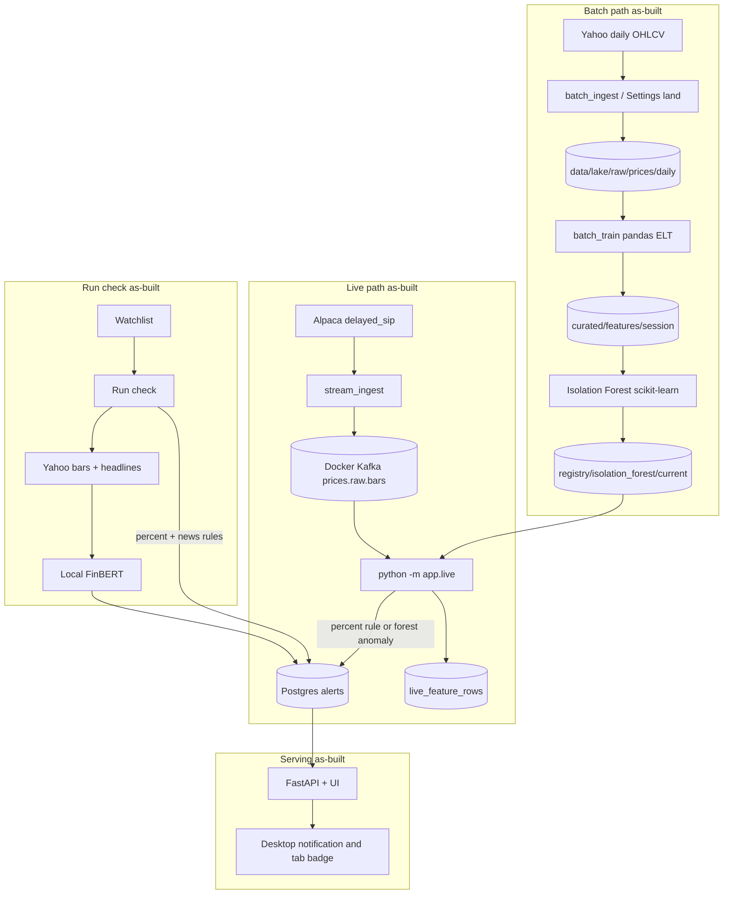
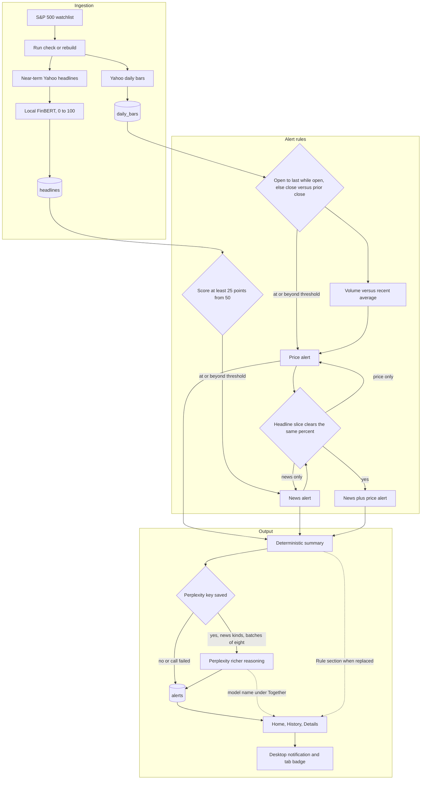
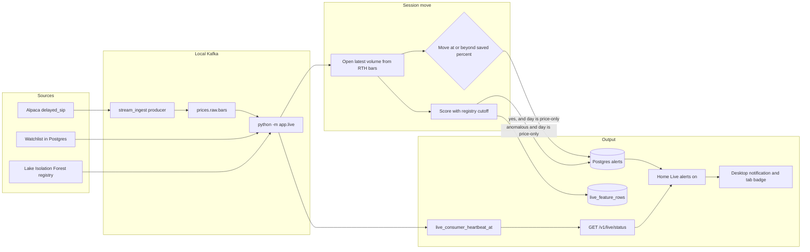
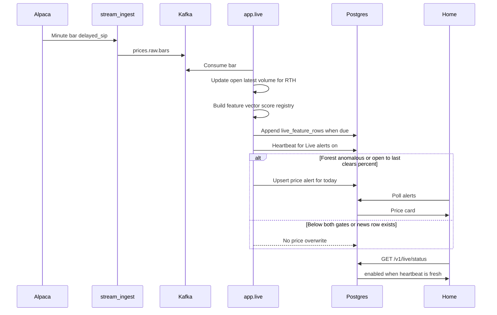
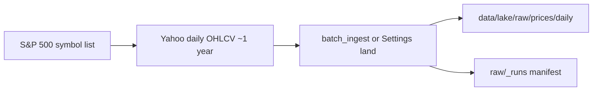
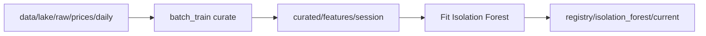
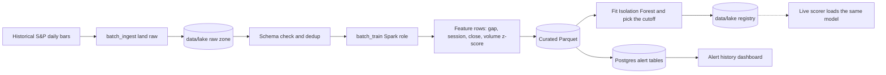
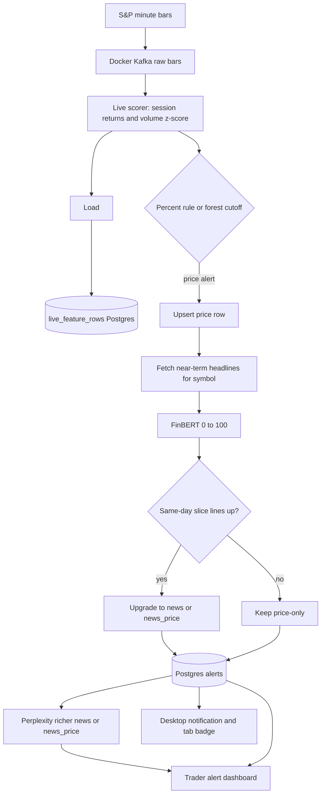
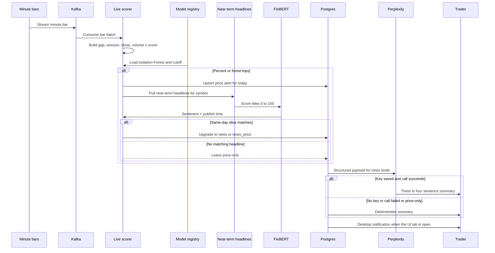

# S&P 500 Alert System architecture

Local decision-support service for the **S&P 500**. A watchlist of index constituents becomes one alert per symbol per day: a price move, a news-sentiment alert, or a news + price alert when both rules fire.

The class design (CISC 525) is a **local** lambda architecture: Docker Kafka on the live path, a batch lake on disk, a Spark-**role** training job, FinBERT for near-term headline sentiment, an Isolation Forest trained on lake price/volume features, and Perplexity for the alert wording. The plan is [proposal-pipeline-audit.md](proposal-pipeline-audit.md).

**Deploy target:** one developer machine (Docker Desktop + Postgres + local lake). Cloud names from the original deck (S3, Aurora, managed Flink) map to local stand-ins below. This project does **not** require an AWS production deploy for the class demo.

This repository runs today:

- Alpaca delayed SIP minute bars onto local Kafka (`stream_ingest/`)
- A FastAPI consumer (`python -m app.live`) that writes open→last **price** alerts for the watchlist (percent rule **and** registered Isolation Forest when the lake registry is present)
- Live feature vectors + forest scores into Postgres `live_feature_rows` (Timescale stand-in)
- Yahoo daily bars and FinBERT headlines on **Run check** (near-term news only) — the live path does **not** yet pull headlines after a price alert
- Perplexity richer reasoning for news / news+price when a key is saved (price-only stays deterministic)
- Batch land of about one year of S&P daily prices into `data/lake/raw/` (`batch_ingest/` or Settings)
- Curated session features + Isolation Forest registry (`batch_train/`)
- Mac/Chrome desktop notifications and a tab badge when new alerts arrive

Still open for the **local final** stack: after a live price move or forest anomaly, **pull near-term headlines for that symbol**, score them with FinBERT, and upgrade the day to news or news+price when the same-day slice lines up (skip stale prior-day stories). A dedicated near-term news topic on Kafka is optional; Run check already scores headlines for the watchlist. Popup “evidence story” UX (price noticed → news checked → evidence / none) and forest-aware price-only wording are also remaining. **Historical headlines are not landed and are not training features.** There is no shared package with Vajra Astra Capital.

## Status

| Capability | Status |
|---|---|
| Watchlist of S&P 500 constituents (focus set for Run check, rebuild, and live price alerts), with ticker and company-name search. Add accepts index constituents only | **As-built** |
| Yahoo daily bars into `daily_bars` for a check | **As-built** |
| Near-term Yahoo headlines scored with local FinBERT (0–100), with confidence and class shares | **As-built** |
| Price alert: open→last while the market is open; close versus prior close after the close. Volume spike note on the completed close | **As-built** |
| News alert and news + price when the headline’s price slice clears the same percent | **As-built** |
| Plain-English summary; Perplexity richer news / news+price reasoning when a key is saved (price-only stays deterministic) | **As-built** |
| Home inbox, Alert History, saved thresholds, admin rebuild of recent sessions | **As-built** |
| Minute bars on Kafka from Alpaca `delayed_sip` (WebSocket ≤30 on Basic; REST fills the rest of the S&P 500) | **As-built** |
| Live Kafka consumer: open→last price alerts (`python -m app.live`); Home “Live alerts on” heartbeat | **As-built** |
| Historical Yahoo daily bars for the S&P 500 (~1 year) in the lake raw zone | **As-built** |
| Spark-role curated feature table (gap, session, close, volume z-score) and Isolation Forest registry via `batch_train` (local pandas/scikit-learn) | **As-built** |
| Live scorer loads the registry and scores session features from Kafka bars (Flink role); Postgres `live_feature_rows` sink | **As-built** |
| Mac/Chrome desktop notification (Notification Center) plus tab title/favicon badge when new alerts arrive from Run check or live | **As-built** |
| Live price → near-term news: after a percent or forest price alert, fetch/score headlines and upgrade to news / news+price when the same-day slice matches | **Local final target** |
| Near-term news topic on Kafka with FinBERT scores (optional bus; Run check remains the near-term headline path today) | **Local final target** |
| Popup evidence story (price noticed → news checked → evidence / none) | **Local final target** |
| Richer forest-aware price-only wording | **Local final target** |

Dropped from both the running design and the local final target: Cassandra, FinBERT fine-tuning, VWAP as a stream stage, a generic LLM box, a historical news lake, sentiment features inside Isolation Forest training, and a mandatory AWS production deploy.

A normal check writes the current Eastern trading day. The admin rebuild deletes saved alerts and reapplies rules over the last 1–40 calendar days for the watchlist. It is not the training lake. Model training reads lake Parquet, not the rebuild.

## Proposal audit

[proposal-pipeline-audit.md](proposal-pipeline-audit.md) is the revised plan. Diagrams below separate **as-built** (running now) from **local final target** (still to wire on this machine). Cassandra, FinBERT fine-tune, VWAP, and a generic LLM box are gone. Historical news is not part of the batch lake. S3/Aurora on older slides mean `data/lake` and local Postgres.

### What this repository does

| Local final target | This app today |
|---|---|
| Minute bars on Kafka, scored by the registered forest | Minute bars on Kafka from Alpaca. `python -m app.live` applies the open→last **percent** rule and scores session features with the registered Isolation Forest; rows land in `live_feature_rows` |
| FinBERT on near-term headlines | FinBERT on each headline during a check. Weights on this machine. No historical news land. Live path does not yet pull headlines after a price alert |
| Slice join, news-only and price-only | Same Eastern day; gap, session, or close slice. On Run check, fusion when that slice clears the price rule. **Local final:** live price first, then look up news for that move |
| Perplexity after the decision | When a key is saved for news / news+price; model name under Together; price-only keeps the rule sentence |
| Lake, Spark-role training, registry | Raw under `data/lake/raw/` via `batch_ingest`. `batch_train` writes curated features and `data/lake/registry/isolation_forest/current/` |
| One alert per symbol per day | One row per symbol per day |
| Notify the trader after the row exists | OS desktop notification + tab badge (`ui/sw-notifications.js`). Slack and email are not used |

### Local stand-ins (no AWS required)

| Original deck / cloud name | Local stand-in in this repo |
|---|---|
| S3 data lake | `data/lake/` Parquet on disk |
| Aurora / RDS | Local Postgres `ticker_alert_db` |
| Managed Kafka | Docker Compose Kafka |
| Spark cluster (EMR / Dataproc) | `batch_train` Spark-**role** job (pandas ELT + scikit-learn Isolation Forest) |
| Flink on Kinesis/MSK | Local Flink-**role** live scorer in `python -m app.live`: same four features + registry cutoff |
| Timescale (managed) | Postgres `live_feature_rows` (Timescale stand-in) |
| Slack / email | Mac/Chrome desktop notification + tab badge |

## As-built: system overview

Everything that runs on one machine today. Live price alerts use the **percent rule** and, when the registry is present, the registered Isolation Forest on the same four session features.

## As-built check

**Run check** or rebuild. Live Kafka price path is the next diagram.

Home asks for notification permission (Enable desktop notifications). When Run check or a live refresh adds alert rows, the open tab raises a Mac/Chrome Notification Center popup and sets `(N)` on the title with a favicon badge. Opening Home clears the unread count. Slack and email are not used.

## As-built live price stream

Docker Kafka, Alpaca producer, and `python -m app.live`. Writes **price** alerts with the **percent rule** and, when the lake registry is present, scores the same four session features with the registered Isolation Forest (Flink role). Anomalous forest scores can also upsert a price alert. Feature vectors land in Postgres `live_feature_rows` (Timescale stand-in). Near-term headlines still come from **Run check** today; the local final step after a live price alert is to fetch and score headlines and upgrade the day when the same-day slice matches. Home reads `/v1/live/status`.

## As-built batch lake land

S&P 500 daily prices only. No historical headlines. Local disk lake (S3 stand-in).

## As-built curated features and Isolation Forest

Local Spark-**role** job [`batch_train`](../batch_train/): pandas ELT + scikit-learn Isolation Forest. Four price/volume features only. Registry under `data/lake/registry/isolation_forest/current/`. Not a Dataproc/EMR cluster; same *job* the diagrams call Spark training.

## Local final target: high-level lambda architecture

Batch trains on **price history** (as-built). Stream scores minute bars with that model (as-built) and, for the product join, **looks up near-term news after a live price alert** (remaining). Everything stays on the local machine. No historical news lake. No AWS requirement.

## Local final target: batch historical ELT

Land raw **prices**, build price/volume features, fit the forest. FinBERT is not fine-tuned and is not a batch input. **This path is as-built** via `batch_ingest` + `batch_train`.

## Local final target: streaming ETL

Minute bars scored by the registered forest (as-built). **Product join is price-first:** when the percent rule or forest marks a live move, the scorer fetches near-term headlines for that symbol, scores them with FinBERT, and upgrades the day to news or news+price when the same Eastern-day slice matches. Stale prior-day stories stay out. A Kafka news topic is optional; Yahoo near-term pull on the alert is enough for the demo. Postgres holds the alert. Perplexity writes after news / news+price rows exist.

## Local final target: end-to-end alert sequence

Price-only and news-only are allowed. The happy path below is **price noticed → news looked up → evidence or none**. Perplexity never decides the alert. The forest features are price and volume only.

## Local schema

`watchlist` holds S&P 500 symbols a check will refresh. `symbols` caches the Yahoo sector or fund category. `daily_bars` and `headlines` are check inputs (near-term headlines only). `app_settings` stores the price fraction, the FinBERT sentiment threshold, the optional Perplexity API key, the selected Perplexity model, and `live_consumer_heartbeat_at` for the Home live cue. The default threshold is 25 points from 50. The default model is `openai/gpt-5.4-mini`. `alerts.kind` is `price`, `news`, or `news_price`. `live_feature_rows` stores live session feature vectors and Isolation Forest scores from `python -m app.live`.

One row per symbol per `bar_date`. A repeated check replaces that day's alert and keeps `created_at`. The row also stores `price_move_threshold` and `sentiment_threshold` from the moment it fired. When Perplexity rewrites Together, the alert `sections` keep the rule sentence, the model id, and the model label shown under Together. A headline is eligible only when it was published on that Eastern trading day and is inside the news lookback.

`sentiment_scorer` stays `finbert`. FinBERT loads ProsusAI/finbert on this machine. The stored score is 0 to 100, with 50 neutral. Confidence is the winning class probability. A headline is eligible when the score is at least the saved number of points from 50.

The lake under `data/lake/` holds raw daily OHLCV, curated session features, and the Isolation Forest registry. It is separate from Postgres alerts.
