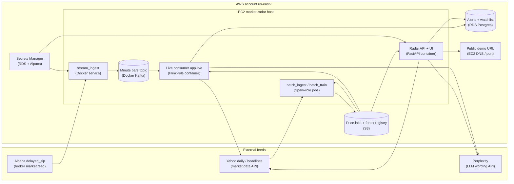

# AWS deployment plan (demo)

**Branch:** `aws-deployment`  
**Status:** decisions locked — ready to implement  
**Audience:** class / professor demo (CISC 525), not production ops  
**Account:** `038084590655` · **Region:** `us-east-1` · **Prefix:** `market-radar-`

This note is the working plan for taking the **already working local** S&P 500 Radar stack onto AWS. `main` stays the local Docker + Postgres + disk-lake demo. This branch adds cloud packaging, Terraform, and diagrams so we can show the same architecture on AWS without rewriting the product.

Local finished-system docs remain the product truth: [architecture.md](architecture.md), [data-sources.md](data-sources.md), [proposal-pipeline-audit.md](proposal-pipeline-audit.md).

---

## Locked decisions

| # | Topic | Decision |
|---|---|---|
| 1 | Compute | **One EC2 instance** running Docker Compose (not EKS / not ECS). Unlocks Explore AWS “Launch an EC2 instance” **$20** credit when done via that checklist. |
| 2 | Kafka | **On the same EC2** (Docker Kafka — same shape as local). Not MSK. |
| 3 | Account / region / names | **Your account** · **`us-east-1`** · prefix **`market-radar-`** |
| 4 | Batch / Spark | **Spark-role jobs on the EC2** (same `batch_ingest` / `batch_train` code) reading/writing **S3**. No EMR. |
| 5 | Secrets / auth | **Alpaca** in Secrets Manager (`market-radar/alpaca`). **Postgres on the EC2** (Docker) by default to save credits — optional RDS via `enable_rds=true`. **Perplexity** entered in the UI after stand-up. **No app login.** |

**Cost posture:** Prefer free-tier / credit-friendly sizes; tear down after the talk. Explore EC2 **$20** unlocked; avoid RDS unless needed (it would burn most of that credit).

---

## Goal

Deploy enough of Radar on AWS that we can open **one dashboard URL** (EC2 public DNS / optional small ALB or `:8010` on a security group) and walk Live, Watchlist Scan today, History, lake refresh, Isolation Forest, FinBERT, and optional Perplexity — end to end — without claiming a hardened multi-tenant production system.

### Explicitly in scope (demo)

- Terraform for VPC bits as needed, **EC2**, **S3** lake bucket, **RDS Postgres** (small), security groups, IAM instance profile, Secrets Manager hooks, optional Elastic IP
- Docker Compose on EC2 for: Kafka, API/UI, live consumer, stream ingest (batch via compose run / cron)
- An **AWS target architecture** diagram (local → cloud mapping)
- Demo checklist (URL, what to click, stop/terminate after)

### Explicitly out of scope (demo)

- EKS / ECS / MSK / EMR (unless the professor later requires those names on a slide — we can label Spark-role / Flink-role on EC2 containers)
- Full production IAM, Cognito login, WAF, multi-AZ DR
- Slack/email pipelines
- Cassandra, historical news lake, FinBERT fine-tune
- Making Alpaca / Yahoo / Perplexity “AWS-native”

---

## What changes on this branch vs `main`

| Area | `main` (today) | `aws-deployment` (planned) |
|---|---|---|
| Runtime | Laptop: Docker Kafka, local Postgres, `data/lake/` on disk | **EC2** + Docker Compose; **RDS**; **S3** lake; same app logic |
| Docs | Local architecture is the finished system | This plan + AWS architecture diagram; local docs stay product reference |
| IaC | `docker-compose.yml` for Kafka | Add `infra/` (Terraform) for EC2/S3/RDS/SG/IAM |
| Packaging | `dev.sh` / venv | Dockerfiles + compose file aimed at EC2; optional ECR |
| Config | Local env / Settings UI | Env from Secrets Manager / instance; Settings UI for thresholds + Perplexity |
| Serving URL | `localhost` | EC2 public DNS (or small LB) — the demo link |
| AuthN to the UI | None | Still none |

**Non-goal:** rewrite Live vs Watchlist, origin, FinBERT gates, or Perplexity-after-decision.

---

## Local → AWS component map

| Local piece | Job | AWS / EC2 stand-in |
|---|---|---|
| `data/lake/` Parquet | Batch price lake | **S3** `market-radar-lake` (raw / curated / registry) |
| Local Postgres | Alerts, watchlist, settings, feature rows | **Postgres container on EC2** (default); optional small RDS |
| Docker Kafka | Minute bar bus | **Kafka container on EC2** |
| `stream_ingest` | Alpaca → Kafka | Container on EC2 (Alpaca from Secrets Manager) |
| `python -m app.live` | Flink-**role** live scorer | Container on EC2 |
| `batch_ingest` / `batch_train` | Land + Spark-**role** train | Compose run / cron on EC2 → S3 |
| FastAPI + UI | Dashboard | Container on EC2, port published |
| Desktop notifications | Browser popup | Same against the public URL |
| FinBERT | Headline NLP | On the API/live image (CPU) |
| Perplexity | LLM wording | UI-entered key after stand-up |

---

## Target AWS architecture (demo)

Same product paths as local: Live → Home Live alerts; Watchlist Scan today → Watchlist results; lake trains Isolation Forest; Perplexity only after news / news+price.

---

## Work checklist (ordered)

### Done

- [x] Branch + planning doc
- [x] Lock compute (**EC2**), Kafka (on-box Docker), account/region/prefix, Spark-role on EC2→S3, secrets approach
- [x] Billing API access for `cursor-deploy` (credits readable)
- [x] Explore EC2 activity completed (**$20** credit); keep instance `market-radar` (`i-0e437ba8984153370`); explore clone terminated
- [x] Secrets Manager `market-radar/alpaca` created
- [x] Terraform scaffold under `infra/` (S3 lake, IAM instance profile, UI port SG rule; RDS optional/off)

### Next (implementation)

1. **`terraform apply`** in `infra/` (S3 + IAM attach to EC2 + open port 8010)
2. **App packaging** — Dockerfiles / compose on EC2 (Kafka + Postgres + API + live + stream_ingest)
3. **Wire config** — lake → S3, Alpaca from Secrets Manager, DB on-box
4. **Smoke** — migrations, land/train, Live, Scan today, History
5. **Presentation + teardown**

---

## Security & access (demo posture)

| Topic | Approach |
|---|---|
| Dashboard login | None — share the URL |
| SSH | Your key / IP only if needed |
| Secrets | Secrets Manager; never commit |
| Network | Open demo port only as wide as needed for the talk |

---

## Cost & teardown

- One small EC2 + small RDS + S3; Kafka on-box (no MSK/EKS control plane)
- Stop or destroy after the presentation
- Watch the $80 monthly budget already on the account

---

## Decision log

| Date | Decision | Notes |
|---|---|---|
| 2026-11-20 | Opened `aws-deployment`; plan-only doc | Professor requires AWS deploy |
| 2026-11-20 | **EC2 + Docker** (not EKS) | Cheaper; unlocks Explore EC2 $20 |
| 2026-11-20 | Kafka on EC2 Docker | Not MSK |
| 2026-11-20 | `us-east-1`, prefix `market-radar-` | Account `038084590655` |
| 2026-11-20 | Spark-role jobs on EC2 → S3 | No EMR |
| 2026-11-20 | Secrets Manager for RDS + Alpaca; Perplexity via UI; no login | |
