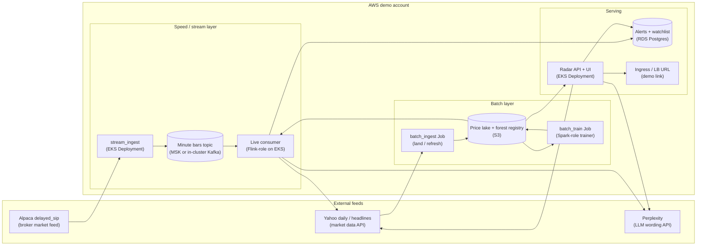

# AWS deployment plan (demo)

**Branch:** `aws-deployment`  
**Status:** planning only — no infra or app changes yet  
**Audience:** class / professor demo (CISC 525), not production ops

This note is the working plan for taking the **already working local** S&P 500 Radar stack onto AWS. `main` stays the local Docker + Postgres + disk-lake demo. This branch adds cloud packaging, Terraform, and diagrams so we can show the same architecture with real AWS boxes.

Local finished-system docs remain the product truth: [architecture.md](architecture.md), [data-sources.md](data-sources.md), [proposal-pipeline-audit.md](proposal-pipeline-audit.md).

---

## Goal

Deploy enough of Radar on AWS that we can open **one dashboard URL** (from the cluster / ingress) and walk Live, Watchlist Scan today, History, lake refresh, Isolation Forest, FinBERT, and optional Perplexity — end to end — without claiming a hardened multi-tenant production system.

### Explicitly in scope (demo)

- Terraform (or Terraform-shaped IaC) for the core AWS pieces
- Container images for the app processes we already run locally
- Kubernetes (EKS or the class cluster pattern the professor expects) for the API/UI and workers
- Managed or cluster-hosted substitutes for Kafka, Postgres, and the price lake
- An **AWS target architecture** diagram (local → cloud mapping)
- Secrets via env / Secrets Manager / sealed values for the demo account — **not** end-user Cognito login for the Radar UI
- A short “how we demo” checklist (URL, what to click, what stays laptop-side if anything)

### Explicitly out of scope (demo)

- Full production IAM posture (SSO, least-privilege review, org SCPs, CloudTrail forensics)
- Public marketing site, custom domain ceremony, WAF, Shield, multi-AZ DR drills
- Cognito / app user accounts / login walls on the dashboard
- Slack/email alerting pipelines
- Real managed Flink/Spark clusters unless the class specifically requires the managed product names (we can keep Spark-**role** / Flink-**role** jobs as containers and label the boxes with AWS service aliases)
- Cassandra, historical news lake, FinBERT fine-tune (still dropped — product decisions do not change)
- Making the Alpaca / Yahoo / Perplexity vendor APIs “AWS-native”

---

## What changes on this branch vs `main`

| Area | `main` (today) | `aws-deployment` (planned) |
|---|---|---|
| Runtime | Laptop: Docker Kafka, local Postgres, `data/lake/` on disk | AWS: cluster + managed/supporting services; same app logic |
| Docs | Local architecture is the finished system | Add AWS deploy plan + AWS architecture diagram(s); keep local docs as the product reference |
| IaC | `docker-compose.yml` for Kafka | Add `infra/` (Terraform) for VPC-ish networking as needed, data stores, cluster wiring |
| Packaging | Run modules with `dev.sh` / venv | Dockerfiles + image build/push for `alert_service`, `stream_ingest`, batch jobs |
| Config | Local env / Settings UI | Cloud config + secrets for DB, Kafka, Alpaca, Perplexity; Settings UI still fine for demo thresholds |
| Serving URL | `localhost` | Cluster ingress / LoadBalancer URL you open for the presentation |
| AuthN to the UI | None | Still none for the demo (know the link; do not build login) |

**Non-goal on this branch:** rewrite the product (Live vs Watchlist, origin, FinBERT gates, Perplexity-after-decision). Cloud is a **deploy target**, not a redesign.

---

## Local → AWS component map (proposed)

Prefer the smallest set that still reads as “big data on AWS” on a slide.

| Local piece | Job | Proposed AWS / cluster stand-in | Notes |
|---|---|---|---|
| `data/lake/` Parquet | Batch price lake | **S3** bucket (raw + curated + registry prefixes) | Closest deck name; batch jobs read/write S3 |
| Local Postgres | Alerts, watchlist, settings, `live_feature_rows` | **RDS Postgres** (single small instance) | One DB is enough; no Aurora required for demo |
| Docker Kafka | Minute bar bus | **MSK Serverless** *or* Kafka in-cluster (Strimzi / bitnami) | Pick one; MSK looks better on slides, in-cluster may be cheaper/faster to stand up |
| `stream_ingest` | Alpaca → Kafka | Deployment / CronJob-friendly Deployment on EKS | Needs Alpaca secrets |
| `python -m app.live` | Flink-**role** live scorer | Long-running Deployment on EKS | Same image family as API or sibling image |
| `batch_ingest` / `batch_train` | Land + Spark-**role** train | Kubernetes Job / CronJob writing to S3 registry | Can stay pandas/sklearn; label as Spark-role unless we must run EMR |
| FastAPI + UI | Dashboard + API | Deployment + Service + Ingress | The one link for the demo |
| Desktop notifications | Browser OS popup | Same (browser against the HTTPS/HTTP URL) | No SNS/email required |
| FinBERT / torch | Headline NLP | Same containers (CPU is fine for demo volume) | Expect larger image / slower cold start |
| Perplexity | LLM wording | Outbound HTTPS from pods + API key secret | Unchanged product behavior |

Open choice to lock before coding: **MSK vs in-cluster Kafka**, and **EKS in our account vs class-shared Kubernetes**. The rest of the plan works either way.

---

## Target AWS architecture (demo)

Draft diagram for slides / this branch. Boxes use the same job + technical role style as the local docs.

Same product paths as local: Live → Home Live alerts; Watchlist Scan today → Watchlist results; both upsert Postgres; lake trains Isolation Forest; Perplexity only after news / news+price decisions.

---

## Work checklist (ordered)

### 0. Decide (before Terraform)

- [ ] Confirm cluster target: **class Kubernetes** vs **our EKS**
- [ ] Confirm Kafka: **MSK** vs **in-cluster**
- [ ] Confirm region / account / naming prefix
- [ ] Confirm whether EMR/managed Spark is required on the slide or Spark-**role** Jobs are enough
- [ ] List secrets we must place: Postgres, Alpaca, Perplexity, optional Grafana-less ops

### 1. Document (this file + diagrams)

- [x] Branch + deployment plan (`docs/aws-deployment.md`)
- [ ] Expand AWS architecture section once Kafka/cluster choices are locked
- [ ] Short “local vs AWS” slide table for the presentation
- [ ] Demo script: URL → Live on → Scan today → History Origin → Settings lake refresh

### 2. Package the apps

- [ ] Dockerfile(s) for `alert_service` (API/UI + ability to run `app.live`)
- [ ] Dockerfile for `stream_ingest`
- [ ] Dockerfile or Job image for `batch_ingest` / `batch_train`
- [ ] Image registry plan (ECR)
- [ ] Config via env (DB URL, Kafka brokers, S3 bucket, lake paths, scorer defaults)

### 3. Terraform / infra

- [ ] Remote state decision (local state OK for demo if documented; S3 backend nicer)
- [ ] Networking: VPC + subnets only as needed for RDS/MSK/EKS (reuse defaults if class cluster already exists)
- [ ] S3 lake bucket + prefixes (`raw/`, `curated/`, `registry/`)
- [ ] RDS Postgres (small, private to the cluster)
- [ ] Kafka (MSK **or** leave to Helm on cluster — document which)
- [ ] ECR repositories
- [ ] IAM roles for pods/jobs (IRSA) — **minimal** read/write to S3 + secrets access; not a full IAM redesign
- [ ] Outputs: bucket name, DB endpoint, brokers, ingress hostname

### 4. Kubernetes manifests / Helm

- [ ] Namespace + ConfigMaps
- [ ] Secrets references (no raw keys in git)
- [ ] Deployments: API/UI, live consumer, stream ingest
- [ ] Jobs/CronJobs: lake land/refresh + retrain
- [ ] Services + Ingress (the demo URL)
- [ ] Resource requests sized for FinBERT CPU demo (honest limits, not prod HA)

### 5. Data & cutover

- [ ] Run migrations against RDS
- [ ] One-time (or Job) historical land into S3 + train registry
- [ ] Smoke: produce a bar → live alert → UI; Scan today → Watchlist results; History Origin
- [ ] Verify Perplexity path with a saved key (optional for the live talk)

### 6. Presentation artifacts

- [ ] Export/render AWS architecture diagram next to the local System overview
- [ ] Note on slides: same lambda pattern; local was the build path; AWS is the deploy path
- [ ] Cost/teardown note so the account can be cleaned after the demo

---

## Security & access (demo posture)

| Topic | Demo approach |
|---|---|
| Dashboard login | **None** — share the ingress URL for the presentation |
| AWS console / kubectl | Team credentials only; not part of the product |
| API keys (Alpaca, Perplexity) | Secrets in AWS / cluster secret store; never commit |
| Network exposure | Ingress URL is enough to “be public” for the talk; no need for a hardened edge stack |
| IAM | Minimal roles for S3 + Secrets + (if MSK) Kafka auth — enough to run, not a security thesis |

---

## Cost & teardown (document before apply)

Rough demo posture (exact numbers depend on MSK vs in-cluster and whether EKS already exists):

- Prefer **stop/destroy after the presentation**
- Prefer **one small RDS**, **one bucket**, **one namespace**
- Prefer **in-cluster Kafka** if MSK Serverless cost is painful for a short demo
- Keep FinBERT on CPU; do not add GPU nodes for class

Add a `terraform destroy` / namespace delete checklist once infra lands.

---

## Risks / watch-outs

| Risk | Mitigation |
|---|---|
| FinBERT image size / memory | Separate slim API image vs “NLP” image if needed; CPU limits documented |
| Lake on S3 latency vs local disk | Same code paths with configurable root (`s3://` or mount); first demo can mount EFS/S3 sync if code changes slip |
| Live consumer + API both need DB/Kafka | Shared env schema; health endpoints already exist for live heartbeat |
| Class cluster constraints | If professor provides Kubernetes, Terraform may only own S3/RDS/secrets and we Helm into their cluster |
| Scope creep into “real prod” | This doc’s out-of-scope list is the brake |

---

## Suggested first implementation slice (after this plan)

1. Lock cluster + Kafka choice with a one-line decision at the top of this file.  
2. Add ECR + Dockerfiles + deploy API/UI to the cluster against **temporary** managed Postgres (or existing class DB).  
3. Point lake at S3; run one batch Job.  
4. Add Kafka + `stream_ingest` + `app.live`.  
5. Freeze diagrams and demo script.

---

## Decision log

| Date | Decision | Notes |
|---|---|---|
| 2026-11-20 | Open `aws-deployment` branch; plan-only doc first | Professor requires AWS deploy for the course; keep demo scope (no app login / full prod IAM) |
| | Cluster target | **TBD** — class K8s vs our EKS |
| | Kafka | **TBD** — MSK vs in-cluster |

When those two TBDs are set, update the diagram labels and start Terraform scaffolding under `infra/`.
