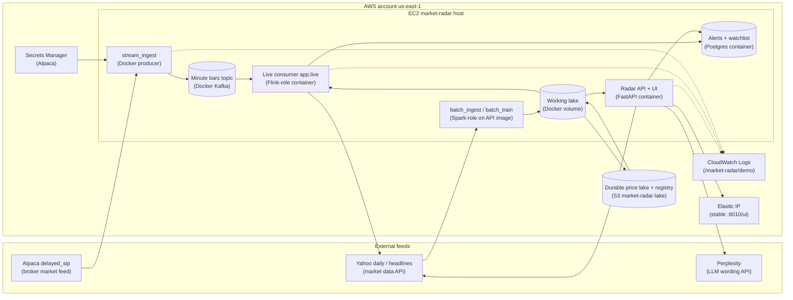

# AWS deployment (demo)

**Branch:** `aws-deployment`  
**Status:** deployed on EC2 (class demo)  
**Audience:** class / professor demo (CISC 525), not production ops  
**Account:** `038084590655` · **Region:** `us-east-1` · **Prefix:** `market-radar-`

This note is the as-built plan for running the **already working local** S&P 500 Radar stack on AWS. `main` stays the local Docker + Postgres + disk-lake demo. This branch adds cloud packaging, Terraform, and the live EC2 Compose stack.

Local finished-system docs remain the product truth: [architecture.md](architecture.md), [data-sources.md](data-sources.md), [proposal-pipeline-audit.md](proposal-pipeline-audit.md).

---

## Locked decisions

| # | Topic | Decision |
|---|---|---|
| 1 | Compute | **One EC2 instance** running Docker Compose (not EKS / not ECS). Unlocks Explore AWS “Launch an EC2 instance” **$20** credit when done via that checklist. |
| 2 | Kafka | **On the same EC2** (Docker Kafka — same shape as local). Not MSK. |
| 3 | Account / region / names | **Your account** · **`us-east-1`** · prefix **`market-radar-`** |
| 4 | Batch / Spark | **Spark-role jobs on the EC2** (same `batch_ingest` / `batch_train` code). Working copy on the EC2 Docker volume; **durable lake of record on S3** `market-radar-lake` (sync after land/train; hydrate on empty boot). No EMR. |
| 5 | Secrets / auth | **Alpaca** in Secrets Manager (`market-radar/alpaca`). **Postgres on the EC2** (Docker) — optional RDS via `enable_rds=true` (off). **Perplexity** entered in the UI after stand-up. **No app login.** |

**Cost posture:** Prefer free-tier / credit-friendly sizes; tear down after the talk. Explore EC2 **$20** unlocked; keep RDS off unless needed.

---

## Goal

Open **one dashboard URL** and walk Live, Watchlist Scan today, History, lake refresh, Isolation Forest, FinBERT, and optional Perplexity — end to end — without claiming a hardened multi-tenant production system.

### Explicitly in scope (demo)

- Terraform for **EC2** profile bits, **S3** lake bucket, security groups, IAM instance profile, Secrets Manager hooks (optional RDS / Elastic IP)
- Docker Compose on EC2 for: Kafka, Postgres, API/UI, live consumer, stream ingest (batch via API land/refresh or compose run)
- An **AWS target architecture** diagram (local → cloud mapping)
- Demo checklist (URL, what to click, stop/terminate after)

### Explicitly out of scope (demo)

- EKS / ECS / MSK / EMR (label Spark-role / Flink-role on EC2 containers if slides need those names)
- Full production IAM, Cognito login, WAF, multi-AZ DR
- Slack/email pipelines
- Cassandra, historical news lake, FinBERT fine-tune
- Making Alpaca / Yahoo / Perplexity “AWS-native”

---

## What this branch adds vs `main`

| Area | `main` | `aws-deployment` (as-built) |
|---|---|---|
| Runtime | Laptop: Docker Kafka, local Postgres, `data/lake/` on disk | **EC2** + Docker Compose; **Postgres container**; working lake on Docker volume; **S3** `market-radar-lake` durable |
| Docs | Local architecture is the finished system | This plan + AWS diagram; local docs stay product reference |
| IaC | `docker-compose.yml` for Kafka | `infra/` Terraform (S3, IAM, SG, CloudWatch, Elastic IP; RDS optional/off) |
| Packaging | `dev.sh` / venv | `deploy/` Dockerfiles + compose + `sync-and-deploy.sh` |
| Config | Local env / Settings UI | Alpaca from Secrets Manager; Settings UI for thresholds + Perplexity |
| Serving URL | `localhost` | EC2 public IPv4 `:8010/ui` |
| AuthN to the UI | None | Still none |
| Live cue | Continuous when consumer runs | Clickable **Live alerts** arm; demo boots **disarmed** (`TICKER_ALERT_LIVE_DISARM_ON_BOOT`) |

**Non-goal:** rewrite Live vs Watchlist, origin, FinBERT gates, or Perplexity-after-decision.

---

## Local → AWS component map

| Local piece | Job | AWS / EC2 stand-in |
|---|---|---|
| `data/lake/` Parquet | Batch price lake | Working copy `/data/lake` + durable **S3** `market-radar-lake` |
| Local Postgres | Alerts, watchlist, settings, feature rows | **Postgres container on EC2** |
| Docker Kafka | Minute bar bus | **Kafka container on EC2** |
| `stream_ingest` | Alpaca → Kafka | `producer` service (Secrets Manager → `alpaca.env`) |
| `python -m app.live` | Flink-**role** live scorer | `live` service |
| `batch_ingest` / `batch_train` | Land + Spark-**role** train | API lake land/refresh jobs on the API image |
| FastAPI + UI | Dashboard | `api` service, port **8010** |
| Desktop notifications | Browser popup | Same against the public URL (Chrome may block on plain HTTP) |
| FinBERT | Headline NLP | On the API/live image (CPU) |
| Perplexity | LLM wording | UI-entered key after stand-up |

---

## Target AWS architecture (demo)

Same product paths as local: Live → Home Live alerts; Watchlist Scan today → Watchlist results; lake trains Isolation Forest; Perplexity only after news / news+price.

---

## As-built demo behavior (operators)

| Topic | Behavior |
|---|---|
| Demo URL | **http://98.94.232.101:8010/ui** (Elastic IP — stable across stop/start; confirm with `terraform output app_url_hint`) |
| Re-deploy | `./deploy/sync-and-deploy.sh` from the laptop |
| Migrations | `deploy/migrate.sh` applies each `db/migrations/*.sql` **once**, tracked in `schema_migrations` (re-running older scripts would `DELETE FROM alerts`) |
| Lake path | Compose mounts volume at `/data/lake`; API image also exposes `/app/data/lake` → `/data/lake` so land, status, and forest registry agree |
| S3 lake | `TICKER_ALERT_LAKE_S3_BUCKET=market-radar-lake`. After successful land/train the API syncs `raw/` + `curated/` + `registry/` to S3. Empty local volume hydrates from S3 on boot; empty S3 gets a one-time push from the volume. |
| Live arm | Home cue toggles `live_alerts_armed`. Boot starts **disarmed** on this host. Producer idles until armed. |
| Bars feed | Settings → **Live WebSocket** picks up to **30** S&P names (seeded with the mega-cap 10). Those stream on Alpaca WebSocket; the rest of the index uses **REST** every 60s (open+last backfill on arm). Producer polls `/v1/live/status` for the list and reconnects when it changes. Env `ALPACA_WS_PRIORITY_SYMBOLS` is fallback only. One Basic WebSocket connection per Alpaca account. |
| Home Clear | Hides Live cards until `updated_at` (or `created_at`) is newer than the clear mark — same-day live refreshes bump `updated_at` and show again. |
| Forest under floor | Isolation Forest under the Settings percent floor without news support is dropped (noise). Percent ≥ floor still alerts without news; polarizing news can still open news-led rows. |
| Settings Clear | **Clear alerts** panel: delete all, or delete rows with \|price change\| under a chosen percent (`POST /v1/admin/alerts/clear`). |
| Chrome notifications | Plain `http://` Elastic IP is an insecure origin. For local demo machines only: `chrome://flags/#unsafely-treat-insecure-origin-as-secure` → enable → add `http://98.94.232.101:8010` → relaunch → Allow notifications on Home. |
| Heartbeat cue | `armed` + fresh heartbeat → **Live alerts on**. Heartbeat runs on a background task so news scoring cannot flip the cue back to **starting…**. |
| Lake header | Shows “Loading historical prices” only while a land/refresh is running (or before raw prices exist); hides when `ok` / `has_raw_prices`. `/ui` is served `Cache-Control: no-store`. |
| CloudWatch Logs | Docker Compose uses the **awslogs** driver → log group **`/market-radar/demo`** (7-day retention). Named streams: `api`, `live`, `producer`, `kafka`, `postgres`, `migrate`. |
| Elastic IP | Allocated + associated via Terraform (`infra/eip.tf`). Stable public IPv4 for the demo URL (not a hostname). **Free while attached to a running instance.** When you stop/tear down the EC2, **release the EIP** (`terraform destroy` on this stack, or disassociate + `aws ec2 release-address`) — an idle/unattached EIP is billed hourly. |

---

## Work checklist (ordered)

### Done

- [x] Branch + planning doc
- [x] Lock compute (**EC2**), Kafka (on-box Docker), account/region/prefix, Spark-role path, secrets approach
- [x] Billing API access for credits
- [x] Explore EC2 activity completed (**$20** credit); keep instance `market-radar` (`i-0e437ba8984153370`); explore clone terminated
- [x] Secrets Manager `market-radar/alpaca` created
- [x] Terraform under `infra/` (S3 lake, IAM instance profile, UI port SG rule; RDS optional/off)
- [x] `terraform apply` — S3 `market-radar-lake`, IAM on EC2, port 8010
- [x] EC2 resized to **t3.medium** / **30 GB** disk for Docker + FinBERT
- [x] `deploy/` Docker Compose stack on EC2 (Kafka, Postgres, API/UI, live, producer)
- [x] Alpaca from Secrets Manager; one-shot migrations; UI + live arm/heartbeat smoke-tested
- [x] Lake path + header hide; REST open+last session backfill; background live heartbeat
- [x] Home Clear uses `updated_at`; live price drafts may re-enter headline upgrade
- [x] Durable lake sync to S3 `market-radar-lake` (hydrate on empty boot)
- [x] CloudWatch log group `/market-radar/demo` + awslogs on Compose
- [x] Elastic IP associated for a stable demo URL (`http://98.94.232.101:8010/ui`)
- [x] Settings → Live WebSocket (≤30) + producer reconnect; REST for the rest
- [x] Forest-under-floor without news dropped; Settings → Clear alerts (all / under %)

### Still optional / later

1. HTTPS in front of `:8010` if desktop notifications are required for the talk
2. Presentation diagram freeze + full teardown when the class is done

---

## Security & access (demo posture)

| Topic | Approach |
|---|---|
| Dashboard login | None — share the URL |
| SSH | EC2 Instance Connect / key as needed |
| Secrets | Secrets Manager; never commit `alpaca.env` |
| Network | Open demo port only as wide as needed for the talk |

---

## Cost & teardown

- One small EC2 + S3 + Kafka on-box + Elastic IP + CloudWatch (no MSK/EKS/RDS by default)
- **When you stop or destroy the EC2 for the night / after the talk:**
  1. `docker compose down` on the host (optional but clean)
  2. Stop or terminate the EC2 instance
  3. **Release the Elastic IP** — do not leave it allocated. Easiest: `cd infra && terraform destroy` for the demo stack (or at least destroy `aws_eip.demo` / run `aws ec2 release-address --allocation-id …`). An EIP that is unattached (or attached to a stopped instance in some cases) **incurs hourly charges**.
- Watch the monthly budget already on the account

---

## Decision log

| Date | Decision | Notes |
|---|---|---|
| 2026-11-20 | Opened `aws-deployment`; plan-only doc | Professor requires AWS deploy |
| 2026-11-20 | **EC2 + Docker** (not EKS) | Cheaper; unlocks Explore EC2 $20 |
| 2026-11-20 | Kafka on EC2 Docker | Not MSK |
| 2026-11-20 | `us-east-1`, prefix `market-radar-` | Account `038084590655` |
| 2026-11-20 | Spark-role jobs on EC2; lake volume first, S3 bucket ready | No EMR |
| 2026-11-20 | Secrets Manager for Alpaca; Postgres on EC2; Perplexity via UI; no login | |
| 2026-11-20 | Live arm + open+last REST backfill + migrator once | Demo stability; avoid FinBERT flood on full-day bars |
| 2026-11-20 | Home Clear on `updated_at`; live upgrade re-enter | Same-day live refreshes stay visible after Clear |
| 2026-11-20 | Durable lake on S3 `market-radar-lake` | Working copy on EC2 volume; sync after land/train |
| 2026-11-20 | CloudWatch `/market-radar/demo` | awslogs from Compose; 7-day retention |
| 2026-11-20 | Elastic IP for demo URL | Release on teardown so idle EIP is not billed |
| 2026-11-20 | Settings Live WebSocket ≤30 + REST long tail | Producer polls list; reconnects on change |
| 2026-11-20 | Forest under % floor needs news; Clear alerts panel | Cut sub-threshold noise; flush under-% rows |
